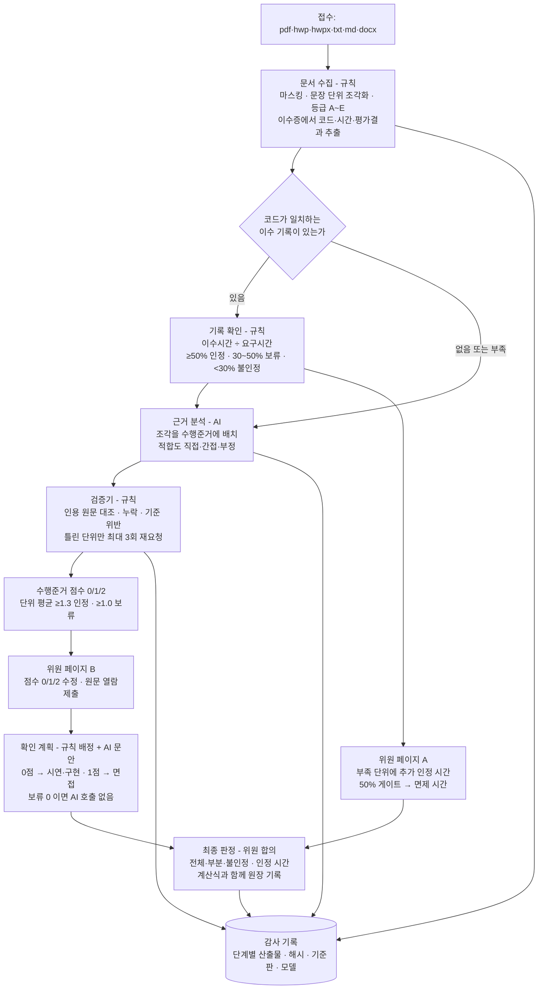

# AI 기반 일학습병행 선행학습인정(RPL) 심사 지원 시스템 「K-RPL」 — 구축과 전문가 검증

**보고서 초안 · 2026-10-05**
한국산업인력공단 발주 · 「일학습병행 RPL 활성화 방안 연구」 · 한국직업능력연구원(과제책임 조성익) · AI 도구 구축 황하

## 초록

일학습병행은 NCS 기반 훈련과정을 기업 현장에서 이수하는 제도이며, 참여자가 이미 갖춘 학습·경력을 훈련시간에서 감면하는 선이수인정(선행학습인정, RPL)은 과정평가형 자격 보유자 등 NCS 코드로 대조할 수 있는 경우에 한정돼 왔다. 비NCS 학습(대학 교과, 민간 학원, 사내 교육)과 경력은 코드가 없어 서류를 사람이 읽고 판단해야 하며, 이 비용이 RPL 확대의 병목이다. 본 연구는 이 병목을 AI 로 낮출 수 있는지를 실제 작동하는 도구로 검증했다.

연구팀은 고시 원자료(일학습병행 교육훈련기준 HWP 350개 → 종목 454개, 과정평가형 편성기준 HWP 214개·HWPX 2개 → 자격 216개)와 NCS 수행준거·KSA 를 데이터베이스로 만들고, 그 위에 심사 지원 시스템 K-RPL 을 구축했다. 시스템은 NCS 코드가 있는 이력을 규칙으로 대조하는 기록 확인(Track A)과, 코드가 없는 문서를 AI 가 문장 단위로 쪼개 NCS 수행준거에 배치하는 근거 분석(Track B)으로 나뉜다. AI 는 판정하지 않고 근거를 배치하며, 위원이 수행준거마다 0·1·2 점을 확인·수정하고 최종 판단한다.

전문가 TF 5회(2026-09-14 ~ 10-07)에서 판정 단위·문턱·근거 등급·확인 계획을 논의했고, 4차·5차에 위원이 가상 사례를 직접 심사하는 체험 세션을 두어 규칙을 실측으로 검증했다. 4차 결과 판정 단위를 항목(KSA)에서 수행준거로 바꾸고 3점 척도를 도입했으며, 4차 합의안(「0 인 수행준거가 없고 평균 1.5 이상」)으로 17건을 재분석하자 근거 분석 8건 중 6건이 전부 불인정이 되어 위원 점수가 판정을 움직일 자리가 없었다. 이에 평균 1.3 이상 인정·1.0 이상 보류의 평균 문턱 방식으로 조정해 5차에 올렸다. 기록 확인 9건은 규칙 변경과 무관하게 설계값과 일치했고, 17건 재분석 비용은 $13.59·99분이었다. 5차 체험 세션(10/7) 결과는 회의 뒤 보강한다.

보고서는 데이터·제도·운영의 한계와 발전 방향, 그리고 제도화를 위한 정책 제언(NCS 데이터 정비, 선이수인정 규정의 비NCS 확장, 심사 위원 운영, AI 활용의 감사 가능성 요건)으로 마무리한다.

---

## 정책 요약 (Executive Summary)

**연구 배경**
- 일학습병행 선이수인정(RPL)은 NCS 능력단위 코드가 일치하고 선행 이수시간이 요구시간의 50% 이상이면 그 단위의 Off-JT 를 면제하는 행정 장치임. 2024~2026 상반기 1,522건·65,162시간이 인정됐으나 대학 교과·민간 학원·사내 교육·경력처럼 코드가 없는 이력은 제도 밖임(3절).
- 병목은 코드 없는 서류를 사람이 읽고 NCS 와의 동등성을 판단하는 비용과 위원 간 편차임. 본 연구는 이 병목을 AI 로 낮출 수 있는지를 실제 작동하는 도구(K-RPL)와 전문가 TF 5회·가상 사례 17건으로 검증함(1절).

**핵심 문제점**
- NCS 데이터가 심사용으로 정비돼 있지 않음 — 지식·기술·태도(KSA)가 수행준거에 연결돼 있지 않고(요소 47,617개 전수 확인), 고용24 의 훈련과정 편성·평가방법은 비공개임(3·8절).
- 판정 문턱이 경험적 출발값이고 미확정임 — 기준서(rubric)의 미확정 기준 9건. 비NCS 학습을 인정할 규정상 근거가 없고 평가자 요건도 없음(8절).
- 유럽·ILO 지침이 요구하는 이의제기·평가자 요건·개인정보·데이터 수집 요소가 현 설계에 없음(2절).

**주요 분석 결과**
- 설계: AI 는 판정하지 않고 제출 문서의 문장을 NCS 수행준거에 **근거로 배치**하며, 수행준거마다 0·1·2 점(직접 근거 2 · 간접만 1 · 없음·부정 0)을 규칙으로 매김. 위원이 점수를 확인·수정하고 최종 판단함. 코드가 있는 이력은 규칙만으로 세는 기록 확인(Track A)과 분리함(4절).
- 전문가 TF: 1차 전제(인정 단위는 능력단위, 최종 판단은 사람) → 2차 세 묶음(인정·보류·불인정) → 3차 증거 등급 A~E 와 직접·간접·부정 → 4차 판정 단위를 KSA 항목에서 **수행준거**로 전환하고 3점 척도 도입. 의견 31건 가운데 반영·일부 반영이 다수이며 미반영 사유를 기록함(5절).
- 체험 세션(4차 9/30): 위원 개별 입력을 다수결로 앱에 넣자 A6 는 부족 3단위가 게이트를 넘어 110h 면제, C4 118/50/40 → 168/0/40h, C8 0/40/280 → 40/220/60h 로 바뀜. 위원은 도구의 유용성과 AI 정리의 정확성을 긍정했고, 근거 공신력 순 정렬·근거 중복 제거·확인 계획 축소를 요구해 반영함(6절).
- 규칙 실측: 4차 합의안(「0 인 수행준거가 없고 평균 1.5 이상」)으로 17건을 재분석하자 근거 분석 8건 중 6건이 전부 불인정이 되어 위원 점수가 판정을 움직일 자리가 없었음. 평균 1.3 이상 인정·1.0 이상 보류로 조정해 5차에 올림. 기록 확인 9건은 설계값과 전부 일치. 17건 재분석 비용 $13.59·99분(7절).
- 5차 체험 세션(10/7): 계획한 8세트 중 4세트(A6·B3·C5·C9)만 진행했고 위원 4명이 응답함(B6·C8·C7·C4 미진행). A6 는 면제 308h(4차 348h — UI 테스트 40h 가 위원 중앙값 10h 로 인정선 미달), B3 는 위원 +15h 가 인정선 20h 에 못 미쳐 면제 280h 그대로, C5(60/160/100h)·C9(165/60/0h)는 위원 다수결이 AI 점수와 다른 문항이 0건이라 판정이 바뀌지 않음. 문턱 1.3/1.0 은 의견만 구했고 0/1/2 척도 유지 여부와 함께 결정 없음. 플랫폼은 현 상태로 종결하고 장단점을 보고서에 함께 제시하기로 함(6.6·7.4절).

**핵심 정책 제언** (주체 → 수단, 8절 표 8-3)
- 고용노동부·산업인력공단 → 운영매뉴얼에 보류 구간·추가 증빙·AI 산출물 검증·이의제기 절차를 먼저 반영하고, 운영규정에 비NCS 학습의 수행준거 기반 심사 절차를 명문화함.
- 한국직업능력연구원·공단 → 3개 분야(IT·회계·건축) 1년 시범 심사로 위원 보정 데이터를 축적해 문턱(1.3/1.0)·보류 구간·직접/간접 경계를 확정함.
- 공단 → 수행준거–KSA 연결, 선택능력단위 수록, 고시 불일치 정정, 고용24 편성·평가방법 공개 등 NCS 데이터 정비. 외부심사위원 자격·2인 이상 평가·AI 와 다른 판단의 사유 기록을 지침화함.
- 공단·훈련기관 → 접수 전 상담과 추가 서류 안내 단계, 학습경험기술서·제3자 확인서 표준 서식, 직무능력인정서·HRD-Net 기록 연동.
- 순서가 핵심임: 문턱 없이 규정을 고치면 심사 부담이 과도해지고, 규정 없이 도구만 두면 재량 심사가 AI 로 포장되는 데 그침. 단기 시범사업이 둘을 잇는 고리임.

---

## 목차

0. [정책 요약](#정책-요약-executive-summary)
1. [서론: 왜 AI 기반 RPL 심사 도구인가](#1-서론-왜-ai-기반-rpl-심사-도구인가)
2. [해외 동향](#2-해외-동향)
3. [국내 동향과 관련 제도·데이터](#3-국내-동향과-관련-제도데이터)
4. [K-RPL 앱의 설계와 작동 방식](#4-k-rpl-앱의-설계와-작동-방식)
5. [전문가 집담회 논의와 앱 반영](#5-전문가-집담회-논의와-앱-반영)
6. [체험 세션: 위원이 직접 심사한 결과와 피드백](#6-체험-세션-위원이-직접-심사한-결과와-피드백)
7. [최종 구현 형태와 사례 판정 결과](#7-최종-구현-형태와-사례-판정-결과)
8. [한계, 발전 방향, 정책 제언](#8-한계-발전-방향-정책-제언)
9. [참고문헌](#참고문헌)
10. [부록: 저장소 안내](#부록-저장소-안내)

---

## 1. 서론: 왜 AI 기반 RPL 심사 도구인가

### 1.1 연구 배경

선행학습인정(RPL)은 학습의 경로가 아니라 성과를 기준으로 개인이 이미 갖춘 역량을 공식 인정하는 제도이다. 유럽연합 이사회 권고(2012)와 CEDEFOP·ILO 지침이 공유하는 틀에서 RPL은 확인–문서화–평가–인증의 4단계로 작동하고, 효율성·통용성·유연성·공정성의 네 원리로 정당화된다(제1차TF 브리핑 설명자료, 2026-09; 2절 참조). 일학습병행은 NCS 능력단위를 기본 단위로 훈련과정과 자격이 결합된 제도이므로, 참여자가 이미 갖춘 학습과 경력을 훈련시간에서 감면하는 장치가 있어야 효율성과 유연성이 실현된다.

그러나 일학습병행의 현행 RPL인 「선이수인정」은 역량 인정이 아니라 중복학습 방지를 위한 행정 장치로 설계되었다. 선행 학습한 능력단위 또는 교과를 훈련 예정 능력단위와 코드로 대조하고 선행 훈련시간이 기준시간의 50% 이상이면 Off-JT 전체를 면제하는 구조이며, 활용 실적과 규칙의 상세는 3절에서 다룬다(제1회 TF 회의 자료집, 2026; 3절 참조).

<표 1-1> 현행 선이수인정의 구조적 한계

| 측면 | 현행 선이수인정 | RPL 관점의 요구 |
|---|---|---|
| 인정 대상 | NCS 기반 형식교육의 이수 이력만 | 비형식·무형식 학습, 직무경력 포함 |
| 인정 기준 | 선행 훈련시간 ≥ 기준시간 50% (이수 사실) | 역량 수준 |
| 판정 방식 | 능력단위별 인정/불인정 이분법 | 부분 충족의 처리, 경계 구간의 구제 |
| 심사 기준 | 유사도 판단 기준 없음, 외부심사자 개인 판단 | 위원 간 공유되는 명시적 기준 |
| GAP 처리 | 장치 없음 | 보완 훈련 안내 |
| 훈련비 구조 | 인정 단위 훈련비 미지급 → 기관 참여 기피 | 부분인정 연동 지원 |

[출처] 제1회 TF 회의 자료집(2026) 제3부; 제1차TF 브리핑 설명자료(2026-09) Ⅱ장

### 1.2 문제 정의: 코드가 없는 이력은 사람이 읽어야 한다

RPL 확대의 병목은 NCS 코드가 없는 학습·경력을 심사하는 비용과 일관성에 있다. 과정평가형 자격이나 NCS 기반 훈련과정처럼 코드가 붙은 이력은 코드와 시간을 대조하는 규칙으로 처리할 수 있지만, NCS가 적용되지 않은 대학 교과, 민간 학원 과정, 사내 교육, 직무경력은 코드가 없으므로 강의계획서·경력기술서·확인서를 사람이 읽고 NCS 능력단위와의 동등성을 판단해야 한다. 심사 현장에서는 NCS와 일치하지 않는 이력이 늘어 외부 전문가 심사가 도입되었으나, 유사도 판단 기준이 없어 위원 간 편차가 크고, 증빙은 강의계획서 한 장으로 부실해졌으며, 심사위원이 학습자에게 추가 확인을 할 수도 없다(제1차TF 토론정리, 2026-09).

이 병목을 AI가 낮출 수 있다는 것이 본 연구의 가설이지만, AI를 어디에 쓸 것인가는 신중하게 정해야 한다. 2026년 8월 가상 지원자 4명의 시범 적용에서 「이수증에 코드·시간·합격이 적혀 있는가」처럼 읽으면 아는 사실까지 AI에 맡기자 같은 지원자의 결과가 세 번 실행에서 15건·15건·12건으로 갈렸고, 원문과 맞지 않는 인용이 1차 46건, 2차 67건 검출되었다(간담회 논의자료, 2026-08-22). 따라서 AI의 몫은 판정이 아니라 「어느 문장이 어느 수행준거의 근거인지」를 원문 인용과 함께 정리하는 일이며, 코드·시간 대조는 규칙으로, 최종 판단은 사람이 맡는다. 이는 1차 TF에서 수렴한 「최종 판단은 사람, 1차 검증·질문 생성은 AI」라는 전제와 일치한다(제1차TF 토론정리, 2026-09).

### 1.3 연구 목적과 범위

본 연구의 목적은 일학습병행에 RPL을 확대 적용할 때 필요한 기준·절차와 제도 개선 방향을 전문가 TF로 논의하고, 그 기준을 실제로 작동하는 AI 심사 지원 도구로 구현하여 가상 사례로 검증하는 것이다. 과업명은 「RPL을 통한 일학습병행과 자격과의 연계를 위한 AI 모델 구축 및 적용 방안의 탐색」, 수행기간은 계약체결일부터 2026년 12월 10일까지이며(과업계획서, 2026-05-19), 논의 범위는 일학습병행 제도 영역 안의 RPL로 한정한다(제1회 TF 회의 자료집, 2026). 과업계획서의 설계 가운데 일부는 TF 논의와 시범 적용 결과에 따라 바꾸었다.

<표 1-2> 과업계획서의 설계와 실제 수행의 차이

| 항목 | 과업계획서(2026-05-19) | 실제 수행 | 바꾼 이유 |
|---|---|---|---|
| 판정 산출물 | 유사도 0~100점, 80%/50% 임계값 | 유사도 점수 없음. 수행준거마다 근거 유무로 0·1·2점, 단위 판정은 규칙(4절) | AI 수치의 재현성 부족, 「최종 판단은 사람」 전제 |
| AI의 역할 | 매핑·유사도 계산·갭 식별·훈련경로 추천 | 문서 조각을 수행준거에 배치(원문 인용·기계 대조), 부정 진술 식별, 확인 계획 문안 | 판정은 규칙과 위원으로 분리 |
| 온톨로지 | NCS–자격 역량 온톨로지(포함·유사·선수 관계) | 고시 원자료 기반 관계형 DB(능력단위 코드로만 연결) | 두 제도의 종목 ID가 달라 코드 외 연결 불가(Data derived README, 2026-08-20) |
| 검증 방법 | Human-AI Co-Model vs AI Agent Model 비교 | 수행하지 않음 — 설계 변경으로 체험 세션(위원 입력 vs AI 점수 비교)으로 대체 | 판정 주체를 사람으로 두어 AI 단독 판정 모델이 없어짐 |
| GAP 트레이닝 | 훈련 경로 추천 | 보류 단위의 확인 방법(시험·면접·외부평가) 안내 | 1차 TF 「GAP 트레이닝은 안내 수준」 전제 |

[출처] 과업계획서(2026-05-19); 제1차TF 토론정리(2026-09); 간담회 논의자료(2026-08-22); K-RPL 판정설계 핵심정리(2026-10-02)

본 연구는 실제 신청자를 심사하지 않았고 모든 사례는 가상이다. 능력단위 내부의 분할 인정, 훈련비 감액 구조, KQF 연계 통용성은 논의하되 구현하지 않았고, 폐지 종목과 선택능력단위는 데이터에서 제외하였다.

### 1.4 연구 방법

연구는 전문가 TF, 데이터 구축, 도구 구축, 가상 사례 검증의 네 축으로 수행하였다. 전문가 TF는 RPL·자격체계, 일학습병행 정책·운영, NCS·국가기술자격, 산업현장, AI 모델 구축의 다섯 유형 위원으로 구성하고 5회 운영하였으며, 4차·5차에는 위원이 도구로 가상 사례를 직접 심사하는 체험 세션을 두었다(5절·6절 참조).

<표 1-3> 전문가 TF 운영 일정

| 회차 | 일시 | 방식 | 주제 |
|---|---|---|---|
| 1차 | 2026-09-14(월) 9:00~11:00 | 대면(서울) | 오리엔테이션: 현행 실태, RPL 확대 방향 |
| 2차 | 09-21(월) 15:00~17:00 | 화상 | Track A — NCS 기반 형식·비형식 교육훈련의 적용 기준 |
| 3차 | 09-23(수) 10:00~12:00 | 화상 | Track B — 비NCS 교육훈련·무형식 경험의 적용 기준 |
| 4차 | 09-30(수) 15:00~17:00 | 화상 | AI 도구 구성 요소 검토, 체험 세션 1(4세트) |
| 5차 | 10-07(화) 15:00~17:00 | 화상 | 체험 세션 2(계획 8세트 중 4세트 진행), 판정 규칙 의견 수렴(확정 결정 없음) |

[출처] 제1회 TF 회의 자료집(2026) TF 일정표; 세션기록(2026-09-30); 사례설명 개요(2026-10-05); 5차 TF 녹취(2026-10-07)

데이터는 고시 원자료에서 직접 구축하였다. 일학습병행 교육훈련기준(고시 제2025-35호, HWP 350개)에서 종목 454개(유효 434·폐지 20)의 필수능력단위별 요구시간을, 2027년 시행 과정평가형 편성기준(HWP 214개·HWPX 2개)에서 자격 216개의 편성 능력단위·시간을 추출해 문서 총계와 대조 검증하였고, NCS 능력단위 13,296개·수행준거 196,646개를 함께 적재하였다(Data derived README, 2026-08-20; 3절 참조).

도구 K-RPL은 코드가 있는 이력을 규칙으로 대조하는 기록 확인(Track A)과 코드가 없는 문서를 AI가 문장 단위로 나누어 수행준거에 배치하는 근거 분석(Track B)으로 구성된다. 판정 규칙은 설정 파일 한 곳에서 관리해 TF 결정이 프로그램 수정 없이 반영되고, AI 산출물은 원문과 기계 대조하며 중간 산출물은 해시와 함께 보존한다(4절 참조).

검증은 가상 사례로 수행하였다. 능력단위 코드·시간은 실제 고시 값을, 학습자·기관·성적·진술은 가상으로 구성한 사례 17건(과정평가형 보유 A1~A6, NCS 민간훈련 B3~B6, 비NCS 교과·경력 C1·C2·C4~C9)을 IT·회계경영·건축 분야에 배치하였다. 4차 체험 세션에서 4세트(A6·C4·C9·C8)를 위원 4~5명이 설문으로 심사해 다수결·중앙값을 도구에 반영하고(세션기록, 2026-09-30), 그 결과 판정 단위를 지식·기술·태도 항목에서 수행준거로 바꾸고 3점 척도를 도입해 17건을 재분석하였다(T5 실행결과, 2026-10-02). 5차 체험 세션은 기록 확인 3세트(A6·B3·B6)와 근거 분석 5세트(C5·C8·C7·C9·C4)로 설계되었다(사례설명 개요, 2026-10-05). 실제로는 A6·B3·C5·C9 4세트만 진행되었고 위원 4명이 응답하였다. 위원 입력 반영 뒤 판정이 바뀐 것은 A6(면제 238h → 308h, 4차 348h)뿐이며, B3·C5·C9 는 그대로였다(5차 집계, 2026-10-07; 6.6·7.4 참조).

### 1.5 보고서 구성

2절은 해외 RPL 동향과 AI 적용 범위를, 3절은 국내 선이수인정 규칙·유사 제도·데이터 한계를 정리한다. 4절은 K-RPL의 두 트랙과 AI·사람의 역할 분담을, 5절은 TF 논의의 반영·보류를, 6절은 체험 세션 결과와 피드백을, 7절은 현재 규칙의 사례 판정 결과를 다룬다. 8절은 한계·발전 방향·정책 제언으로 마무리한다.

---

## 2. 해외 동향

유럽과 ILO 의 RPL 지침은 공통적으로 ① 학습성과 기반 표준을 기준점으로 삼고, ② 증거를 모아 표준에 대조하며, ③ 이해관계가 없는 훈련된 평가자가 최종 판단하고, ④ 그 과정을 투명하게 공개·감사할 것을 요구한다. 두 문헌 모두 디지털 도구를 식별·안내 단계의 보조 수단으로만 다루며, AI 를 심사에 쓰는 방법에 관한 지침은 없다. 본 절은 두 문헌에 서술된 내용만을 근거로 한다.

### 2.1 유럽 — 4단계와 운영 원칙

유럽 가이드라인(Cedefop, 2023)은 2012년 EU 이사회 권고에 따라 비형식·무형식 학습의 인정(validation)을 **식별 → 서류화 → 평가 → 인증** 의 4단계로 정의한다. 자격 취득이 목적이면 평가·인증의 엄밀성이, 자기 인식이 목적이면 식별·서류화가 중심이 된다(§2.2~2.3). 출발점은 「언제 어디서 얻었든 모든 학습은 잠재적으로 가치가 있다」, 「형식·비형식·무형식 학습은 서로 보완한다」는 두 원칙이며(Ch.1), 자발적 참여·절차 중단권·이의제기·개인정보 보호·역할 분리를 뜻하는 **개인 중심** 원칙이 전 단계를 관통한다(§2.1).

단계별 요건은 다음과 같다. **서류화**의 증거는 외부 독자가 학습성과를 판단하고 신뢰할 수 있어야 하며, 직책을 나열하는 것만으로는 부족하다(§2.2.2). **평가**는 학습성과를 기준점·표준에 대조하는 작업이므로 학습성과 기반 표준이 전제이고, 「어디서·얼마나 오래」 같은 투입 요소는 증거의 무게를 정하는 데 쓰일 수 있다. 평가의 신뢰는 도구·절차의 투명성, 명확한 표준과의 연결, 모든 단계가 비판적 검토에 열려 있는 품질보증에 달려 있다(§2.2.3). 기준점이 보이지 않거나 형식교육과 다른 표준을 쓰면 「A급·B급 자격」이 생긴다(§4.1.2).

**평가자**는 증거를 찾고 검토·확인해 표준 충족 정도를 판단하는 사람으로, 표준과 평가 방법에 익숙하고 해당 분야 전문가로 인정받으며 후보자와 어떤 관계도 없어야 한다. 일정 연수의 현장 경력과 절차 교육을 요구하며, 2인 이상 평가는 신뢰도를 높이지만 비용도 높인다(§3.5.2). 상담자와 평가자의 역할 분리를 감독하는 **외부 관찰자**를 별도로 둔다(§3.5.3). **품질보증**은 계획–실행–점검–개선 순환으로 상시 운영하되, 유럽의 가장 큰 공백은 「모니터링·평가를 가능하게 하는 체계적 데이터 수집의 부재」라고 지적한다(§4.5).

### 2.2 ILO — 개도국·현장 중심 운영 요소

ILO 학습패키지(ILO, 2018)는 개도국의 비공식 경제 노동자를 염두에 둔 교육자료이다. 일반적 RPL 과정을 ① 인지·정보 → ② 상담·촉진(사전 선별, 포트폴리오 작성 지원, 격차 훈련 안내) → ③ 평가·인증(평가자의 증거 검토, 필요 시 시험·시연, 미흡 사항 통지, 이의제기, 수여)의 3단계로 제시하고(Table 1.1), 제도의 구성 요소로 규제 틀·기관 틀·이해관계자 참여·재원 넷과 이를 관통하는 품질보증을 든다(Figure 2.1).

표준에 관해서는 「평가 표준은 형식 교육훈련과 동일해야 하지만 평가 절차는 달라야 한다」고 명시하며(§5.2), 자격은 모듈형·역량 기반이어야 한다(§4.2). 평가는 투명·타당·신뢰해야 하고, 핵심 요소는 증거, 훈련된 상담자·평가자, 접근 가능한 안내, 「실제 역량과 그것이 문서화된 방식」이다(§5.1). 평가자는 유럽 기준을 인용해 현장 경력 5년이 통상적이라 하고, 여러 나라가 평가자 등록·인가와 유효기간이 있는 면허, 성과 모니터링을 요구한다고 소개한다(Table 4.3). 판단 일관성을 위한 수단으로 **조정(moderation)** 과 독립 감사를 든다(§4.3~4.4).

포트폴리오는 가장 널리 쓰이지만 「형식교육이 적은 사람에게 언어·복잡성이 장벽」이 되므로, 「단순하지만 신뢰할 수 있는」 혁신적 평가 방법이 여전히 필요하다고 적는다(§5.2~5.3).

### 2.3 증거·평가 방법 비교

두 문헌은 증거를 종류별로 나누고, 방법마다 타당도·신뢰도·확장성·비용이 다르므로 조합해 쓰라고 권한다.

| 항목 | Cedefop (2023) | ILO (2018) | K-RPL 설계의 대응 |
|---|---|---|---|
| 기준점 | 학습성과 기반 표준. 직무 표준은 과업 지향이라 범위가 좁을 수 있음(§4.1.2) | 형식교육과 동일한 표준, 모듈형·역량 기반(§4.2) | NCS 능력단위 → 요소 → 수행준거(4절 참조) |
| 증거 종류 | 서류·작업 샘플·시연·제3자 보고(§2.2.2) | 직접(관찰·시연·작업물) / 간접(직무기술서·근무기록) / 과거(추천서·수료증)(Table 5.1, 퀸즐랜드) | 문서 신뢰도 등급 A(공적증빙)~E(본인진술), 근거 적합도 직접·간접·부정 |
| 증거 무게 | 투입 요소(어디서·얼마나)가 무게를 정할 수 있음(§2.2.3) | 증거 검토 후 필요 시 시험·시연(Table 1.1) | 이수시간 비율 4단계(Track A), 수행준거 점수 0·1·2(Track B) |
| 포트폴리오 | 4단계 모두에 쓰임, 증거 조합이 타당도·신뢰도를 높임, 제3자 심사 권고(Table 1, §5.4.8) | 가장 널리 쓰이나 안내 부족·언어 장벽. e-포트폴리오는 기술이 목적을 가릴 위험(§5.3) | 문서를 문장 단위로 쪼개 수행준거에 배치, 원문 인용 필수 |
| 보완 확인 | 면담은 서류 내용을 탐침하는 보조 수단, 관찰·시뮬레이션은 타당도 높음(§5.4.4~5.4.6) | 슬로베니아: 포트폴리오로 불명확한 부분만 시험. 벨기에(플랑드르): 포트폴리오 → 실제 상황 평가(Table 5.2) | 보류 수행준거를 0점 → 외부평가 실기, 1점 → 면접으로 배정 |
| 최종 판단 | 이해관계 없는 전문가 평가자, 2인 이상 권장(§3.5.2) | 등록·훈련된 평가자, 조정·감사(§4.3~4.4) | 위원이 점수를 확인·수정하고 판단, AI 는 근거 배치만 |
| 품질보증 | 투명성, 이의제기, 체계적 데이터 수집(§2.2.3, §4.5) | 품질 코드, 기관 인가, 조정, 독립 감사, M&E(§4.4.1) | AI 산출물을 원문과 대조 검증, 위원 판정 저장 |

[출처] Cedefop(2023) §2.2, §3.5, §4.1.2, §4.5, Table 1, §5.4; ILO(2018) Table 1.1, §4.2~4.4, §5.1~5.3, Table 5.1~5.2; K-RPL 대응은 `rubric_v0.2.yaml`·`K-RPL_판정설계_핵심정리.md`.

### 2.4 디지털·AI 도구에 관한 언급

두 문헌에는 AI 를 심사에 활용하는 방법에 관한 지침이 없다. Cedefop(2023)의 유일한 AI 언급은 「인공지능 활용은 개인의 기능 프로필을 학습·일·자원봉사 기회와 더 잘 매칭할 기회를 줄 수 있다」(§4.4)는 한 문장이며 심사·판정에 관한 것이 아니다. 같은 문헌은 ICT 기반 식별 도구가 「확장성이 높고 비용이 낮지만, 표준화된 성격 때문에 개인의 복합적 역량 조합을 식별하는 능력이 떨어질 수 있다」(§2.2.1)고 경계하고, ICT 는 품질보증·통제, 개인정보 보호, 정보 공유에 대한 개인의 선택권과 짝지어야 한다고 적는다(§4.4). ILO(2018)에는 AI 언급이 없으며, ICT 사례는 식별·안내·행정 단계의 도구(호주 퀸즐랜드의 웹 자가진단, 인도의 신청자 진행 추적 포털)에 그친다(§4.1, §6.3).

### 2.5 시사점

**K-RPL 의 기본 구조는 두 문헌의 요건과 맞닿아 있다.** 수행준거를 기준점으로 삼은 것은 학습성과 기반 표준 요건에, 문서를 신뢰도 등급과 직접·간접 적합도로 나눈 것은 퀸즐랜드형 증거 분류와 「투입 요소가 증거 무게를 정한다」는 서술에, 보류 수행준거를 면접·실기로 넘기는 확인 계획은 슬로베니아·벨기에의 2단계 방식에, AI 가 배치만 하고 위원이 판단하는 분담은 평가자 요건에 대응한다. ILO 가 요구한 「단순하지만 신뢰할 수 있는」 방법의 공백을 AI 보조로 메우려는 시도라는 점에서도 문제의식이 같다.

반면 두 문헌이 요구하지만 현 설계에 없거나 미확정인 요소도 있다. 이의제기 절차와 절차 중단권, 접수 전 상담 단계(현재는 보류 단위에 대한 추가 증빙 안내만 있다), 평가자 자격·등록·교육 요건과 2인 이상 평가 또는 조정, 판단 일관성을 모니터링하는 데이터 수집·M&E, 개인정보 보호와 정보 공유 선택권이 그것이다. 이들 제도화 과제는 8절에서 다룬다(8절 참조).

끝으로 Cedefop 의 「표준화된 ICT 도구는 복합적 역량을 놓칠 수 있다」는 경고는 K-RPL 에도 적용된다. 앱은 문서의 문장을 수행준거에 배치하므로 수행준거 문구에 직접 대응하지 않는 경험은 근거로 잡히지 않는다. 이를 보완하는 장치가 위원의 점수 수정과 면접이며, 두 문헌이 면담을 서류의 보조 수단으로 둔 것과 같은 자리이다.

---

## 3. 국내 동향과 관련 제도·데이터

### 3.1 현행 선이수인정 규칙과 적용 범위

일학습병행의 선이수인정은 「선행 이수시간이 신청 능력단위 요구시간의 50% 이상이면 그 능력단위의 요구시간 전체를 인정」하는 규칙이며, NCS 능력단위 코드가 일치하는 Off-JT 능력단위에만 적용된다. 2017년 IPP형에서 공식화되고 2020년 도제학교로 확대되었으며, 중복 이수 방지가 목적이었으므로 출발부터 역량 평가가 아니라 교과목과 코드를 대조하는 행정 장치로 설계되었다(제1회 TF 회의 자료집, 2026; 김민규, 2023a). 법령이나 운영규정(고용노동부고시 제2025-99호)에 직접 규정되어 있지 않고 공단 「일학습병행 운영매뉴얼」(pp.124~125)과 PDMS 안내로 운영된다(제1차 TF 브리핑 설명자료, 2026).

<표 3-1> 현행 선이수인정의 규칙과 적용 범위

| 항목 | 내용 |
|---|---|
| 인정 대상 | 훈련 참여 이전 이수한 NCS 능력단위·전공 교과(매뉴얼은 「비NCS 기반 포함」이라고도 적음) |
| 인정 범위 | 훈련 예정 필수·선택 능력단위 중 Off-JT 에 한정. On-JT 제외 |
| 신청 요건 | 선행 이수시간 ≥ 해당 능력단위 기준 훈련시간의 50% |
| 판정 | 충족 시 그 능력단위의 Off-JT 전체 면제. 능력단위 단위의 인정/불인정 이분법 |
| 심사 단위 | 기관 단위. 개인 성취 수준이 아니라 교과목·능력단위 유사성만 심사 |
| 제출 서류 | 기관: 선이수 능력단위 이수 확인서 / 개인: 선행훈련 교과 강의계획서 |
| 적용·훈련비 | 개인 단위는 학습일지 「0월차」에 산입(과정 재편성 없음). 인정 단위 Off-JT 훈련비 미지급 |

[출처] 제1회 TF 회의 자료집(2026) 제3부; 제2차 TF 브리핑 설명자료(2026) Ⅱ장

활용 규모는 2024년~2026년 상반기 승인 1,522건·65,162시간이며 개인단위가 68.5%, 개인단위의 외부심사 비중이 79.8%이고, 평균 인정시간 42.1시간(기관단위 44.4시간)은 45시간(대학 3학점 교과목)에 집중된다(제1회 TF 회의 자료집, 2026). 인정 단위가 역량이 아니라 교과목 시수임을 보여준다.

적용 범위는 두 방향에서 막힌다. 코드가 없는 비NCS 교과·민간 훈련·사내 교육·경력은 인정될 길이 없고, 코드가 있어도 50% 미달이면 전부 불인정이며 GAP 훈련 장치가 없다. 다만 「50%만 이수해도 100% 인정」은 능력단위 하나를 놓고 보면 이미 부분인정이며, 2차 TF 는 이 규칙을 과정평가형 자격에 그대로 적용하는 데 합의했고 시간 50% 미만 단위는 세 입장(불인정 / 30~50% 보류 / 자격 단위 인정)이 병존한다(제2차 TF 토론정리, 2026; 5절 참조). 현장에서는 NCS 와 맞지 않는 이력을 강의계획서로 받아 외부심사위원에게 「넣어 달라」고 요청하는 사례가 늘었고 유사도 기준이 없어 위원 간 편차가 크다(제2차 TF 브리핑 설명자료, 2026). 비NCS 이력의 재량 심사는 이미 벌어지고 있으며, K-RPL 은 이를 기준 안으로 끌어들이려는 시도이다.

### 3.2 유사·관련 제도

투입 자료가 될 수 있는 국내 제도는 다섯 가지이며, 「코드가 있는가」와 「누가 품질을 보증하는가」에서 갈린다.

<표 3-2> 일학습병행 RPL 과 관련된 국내 제도

| 제도 | 근거·운영 | NCS 코드 | 품질 보증 | RPL 에서의 위치 |
|---|---|---|---|---|
| 과정평가형 국가기술자격 | NCS 과정 이수 후 내·외부평가 합산 80점 이상. 종목별 편성기준 고시(필수 단위별 시간, 허용범위 80~150%). 216자격 | 있음 | 국가 검정 | Track A-1. 현행 규칙 그대로 적용 가능 |
| NCS 기반 민간훈련(내일배움카드·HRD-Net 등록) | NCS 능력단위로 편성·등록. 수료증·이수확인서로 증빙 | 있음 | 외부 검증 없음 | Track A-2. 코드 대조 가능, 증빙 신뢰도 등급화 필요 |
| 사업주자격 정부인정제(기업자격) | 「국민 평생 직업능력 개발법」 제7조의2, 고용노동부고시 제2024-61호. 영리 검정 금지·우대 규정 필수. 정부인정 유효 3년, 직무능력은행 연계 | 없음 | 정부 인정 심사(검정 조직·출제·사후관리) | Track B. 일반 사내자격과 구분해 국가 인정에 준해 활용 가능. 안전·품질 자격은 건설기술인 배치기준과 얽혀 당장 어려움 |
| 직무능력은행제·직무능력인정서 | 같은 법 제25·26조. 자격·훈련·교육·경력 정보를 모아 인정서 발급. 2026.1 말 18개 시스템 연계, 가입 109,791명, 발급 112,255건 | 자격·훈련 정보만 | 정보 축적·조회, 역량 검증 아님 | Track B-2 증빙 창구. 경력 기간만 확인. 교과인정 심의기준은 위원 가이드로 활용 가능 |
| 국가기술자격 연계(연계맵) | 자격 간 필수능력단위 유사성 비교로 통용성 확보. 2025.9 「일학습병행자격과 국가기술자격 연계에 관한 고용노동부 고시」(고시 번호 미확인) | 있음 | 전문가 위원회 검토 | 자격 대 자격 매칭. 본 연구(능력단위 대 능력단위)와 접근이 다름 |

[출처] 제1회 TF 회의 자료집(2026) 제5부; 제2차 TF 브리핑 설명자료(2026) Ⅲ장; 제3차 TF 브리핑 설명자료·토론정리(2026); 김민규 외(2025) 요약; Data(20260812)/derived/README.md(2026-08-20)

과정평가형 자격은 편성기준 대조만으로 판정이 끝나지만, 자격증에 능력단위별 합격 여부가 없어 자격 취득은 「능력단위 전체 이수로 간주」하는 증빙이고, 훈련기관이 시간을 80~150% 범위에서 조정할 수 있어 편성기준 값만의 판정은 하한에서 뒤집힐 수 있다(제2차 TF 브리핑 설명자료, 2026). K-RPL 의 「확정/추정(이수증명 필요)」 구분은 여기서 나온다(4절 참조).

연계맵 연구는 선행연구로 참고하되 수치를 맞추지 않는다. 김민규(2023b)는 과정평가형 179종목과 일학습병행자격 434종목의 필수능력단위를 전수 비교해 「1:1 매칭 또는 개수 기준 70% 이상 동일 편성」 종목을 후보로 뽑고 9개 대표 종목 중 7개를 「아주 유사(95% 이상)」, 2개를 「유사(90~94%)」로 판정했으며, 김민규 외(2025)는 21종목 중 16개를 연계 가능으로 분류하고 불일치 종목은 「과목 면제 및 RPL」로 풀 것을 제안했다. 이들은 종목 단위·개수 기준의 자격 간 매칭이고 본 연구는 능력단위 단위·시간 기준이며 훈련기준도 개편된 것(고시 제2025-35호, 2027년 시행 편성기준)을 쓰므로, 결과가 달라도 어느 쪽에 맞추지 않는다.

### 3.3 쓸 수 있는 데이터와 그 한계

데이터는 고시 원자료로 만든 두 데이터베이스이다. 일학습병행 교육훈련기준(고시 제2025-35호) HWP 350개와 과정평가형 편성기준(2027년 시행) HWP 214개·HWPX 2개에서 표를 복원해 만든 `krpl.sqlite`(2026-08-20)와, NCS 정보망 DB(2026년 2월)의 수행준거·KSA 를 적재한 `ncs_ksa.sqlite` 이다. 두 제도는 종목 ID 체계가 달라 연결은 오직 NCS 능력단위코드 10자리로만 이루어진다(Data README, 2026-08-20).

<표 3-3> K-RPL 데이터베이스의 구성

| 구분 | 내용 | 규모 |
|---|---|---|
| 일학습병행 종목 | 종목 × 수준(L2~L5), 필수능력단위별 요구시간·하한(50%) | 454종목(유효 434·폐지 20), 3,988행 |
| 과정평가형 자격 | 자격별 편성 능력단위·시간, 허용범위(80~150%) | 216자격, 2,030행 |
| NCS 능력단위 / 요소 | 코드·수준·표준훈련시간 / Track B 세로축 | 13,296개 / 47,617개¹ |
| 수행준거 / KSA | 요소별 「…할 수 있다」 문장 / 지식·기술·태도 항목 | 196,646개(요소당 1~22, 평균 4.1) / 2,457,444개 |
| 매칭 뷰 | 자격 × 종목 쌍의 인정률 지표 3종 | 537쌍(유효 523쌍), 질의 시 계산 |

[출처] Data(20260812)/derived/README.md(2026-08-20); App/README.md(2026-10-02)
¹ 앱 DB 기준. derived README(2026-08-20)의 `dim_unit_element` 는 47,199개로 빌드 시점이 다르다. [자료 보완 필요]

유효 523쌍을 현행 규칙으로 환산한 인정률은 <표 3-4>와 같다(비교 단위는 자격 × 수준).

<표 3-4> 과정평가형 자격 × 일학습병행 종목 인정률 구간 분포

| 구간 | 쌍 수 | 비고 |
|---|---|---|
| 인정률 50% 이상 | 121 | 이 중 인정률 100% 14쌍 |
| 30% 이상 50% 미만 | 57 | 연구진이 제안한 보류 구간 후보 |
| 30% 미만 | 345 | 코드 불일치가 대부분 |
| 계(유효 종목) | 523 | 폐지 종목 제외. 전체 537쌍 |

[출처] krpl.sqlite `v_credit_matrix`(2026-09-17 계산); 제2차 TF 브리핑 설명자료(2026) Ⅳ장

지표는 세 가지를 구분해야 한다. 축산기능사 → 가금사육_L3 은 9개 단위가 모두 코드 일치하지만 전부 시간 부족이라 확정 인정률 0%이며, 코드 일치율 100%는 32쌍이나 시간까지 충족하는 쌍은 1쌍뿐이다(Data README, 2026-08-20).

<표 3-5> 인정률 지표 세 가지

| 지표 | 정의 | 용도 |
|---|---|---|
| 인정률(주 지표) | 단위별 이수시간 ≥ 요구시간의 50% 이면 요구시간 전체 인정 → Σ ÷ 필수 총시간 | 현행 규칙의 환산값. 구간 분류 기준 |
| 이수시간 충족률 | Σ min(이수시간, 요구시간) ÷ 필수 총시간 | 실제로 겹치는 시간의 참고값 |
| 코드 일치율 | 코드 일치 단위 수 ÷ 필수 단위 수 | 시간과 무관한 참고값 |

[출처] Data(20260812)/derived/README.md(2026-08-20)

NCS 데이터에는 구조적 한계가 있다. 정보망 DB 의 KSA 는 요소 단위로 정의되어 그 요소의 모든 수행준거에 복제되어 있으므로(47,617개 요소 전수 확인, 예외 0) 수행준거↔KSA 매핑은 존재하지 않으며 만들 수도 없다. K-RPL 이 판정 단위를 수행준거로 바꾸고 AI 입력에서 KSA 를 뺀 이유이다(App README, 2026-10-02; 4절 참조). 원자료도 손질이 필요했다. NCS 능력단위 목록은 훈련시간이 두 시트에서 12.4%(1,651개) 달라 2026년 고시 값을 채택했고, 기준서 2건은 총계가 맞지 않거나 없으며, 별표와 기준서의 수준 표기가 다른 종목이 1건(전기자동차정비) 있다. 선택능력단위는 미수록이라 인정률은 보수적 하한이다(Data README, 2026-08-20).

공개 데이터로 얻을 수 없는 것도 분명하다. 고용24 에서 일반 과정의 능력단위 편성은 「교과편성 연계표」로 확인되지만 산대특·K-디지털 과정은 편성이 공개되지 않고, 평가방법·수료기준은 어떤 과정에도 공개되지 않는다(연구진 조회 기록, 2026-09 [자료 보완 필요: 조회 일자]). 과정평가형의 능력단위별 합격 데이터는 공단만 보유하고(제2차 TF 브리핑 설명자료, 2026), 기능사·기사 필기 기출은 큐넷 미공개다(App README, 2026-09-24 확인). 따라서 NCS 기반 민간훈련은 코드가 있어도 「어떻게 평가해 수료시켰는가」를 알 수 없고 이수증의 내부평가 기재에 의존한다.

### 3.4 시사점

첫째, 현행 규칙은 환산 가능한 기준선이다. 「코드 일치 + 50%」는 이미 부분인정이고 편성기준만으로 537쌍을 기계적으로 판정할 수 있으므로, 제도 변경 없이 코드가 있는 심사는 즉시 자동화할 수 있다. 둘째, 병목은 코드가 없는 이력이며 그 심사는 이미 재량으로 벌어지고 있다. 정부인정 사업주자격·직무능력은행·평생학습계좌제처럼 제3자가 품질을 보증한 투입부터 받자는 3차 TF 의 방향은, 이들만이 발급기관·유효기간·연계 정보를 갖춰 증빙 등급을 매길 수 있다는 점에서 데이터 측면에서도 타당하다. 셋째, 수행준거↔KSA 매핑 부재, 시트 간 훈련시간 불일치, 고시 문서 간 수준 표기 불일치, 합격 데이터와 민간훈련 평가방법의 비공개는 연구진이 우회했을 뿐 해소하지 못한 제약이며 소관기관의 과제이다(8절 참조). 넷째, 자격 간 연계맵(어느 자격이 통용되는가)과 본 연구의 매트릭스(어느 종목에서 몇 시간을 감면받는가)는 보완 관계이며, 함께 두면 훈련 감면과 응시요건 연계를 한 체계에서 안내할 수 있다.

---

## 4. K-RPL 앱의 설계와 작동 방식

K-RPL 앱은 접수 한 건에 두 판정을 수행한다. NCS 코드가 있는 이력은 규칙으로 대조하는 「기록 확인」(Track A), 코드가 없는 문서는 AI 가 문장 단위로 쪼개 NCS 수행준거에 배치하는 「근거 분석」(Track B)이다. 두 판정 모두 시스템은 자료를 정리하고 규칙으로 셀 뿐이며, AI 는 판정하지 않고 근거를 배치하고, 최종 판단은 위원이 한다(K-RPL 판정설계 핵심정리, 2026-09-25). 규칙이 바뀐 경위는 5절, 가상 사례 17건의 판정 결과는 7절에서 다루며, 두 절은 이 절의 <표 4-4>를 정본으로 참조한다.

### 4.1 설계 원칙

설계 원칙은 네 가지이며, 모두 「AI 산출물을 그대로 믿지 않아도 되게 한다」는 한 방향을 향한다(App README 「설계 원칙」).

첫째, **AI 는 판정하지 않고 근거를 배치한다.** 숫자와 요건으로 가릴 수 있는 것(코드 일치, 훈련시간 비율, 이수증 요건)은 규칙으로 확정하고, AI 는 제출 자료의 어느 문장이 NCS 의 어느 수행준거를 뒷받침하는지 배치하고 확인 방법을 제안하는 데만 쓴다. 「의미론적 유사도 %」 같은 수치는 없으며, 집계되는 수치는 수행준거마다 매겨지는 0·1·2 점뿐이다.

둘째, **모든 수치와 규칙은 기준서 한 곳에서 가져온다.** 판정에 쓰이는 값은 심사 기준 파일(rubric v0.2) 하나에 있고, TF 에서 값이 정해지면 해당 줄만 바꾼다. 미확정 항목은 목록으로 관리되며(2026-10-02 현재 9건), 운영 환경에서는 미확정 항목이 남아 있으면 기동을 거부한다.

셋째, **단계별 산출물을 감사 가능하게 저장한다.** 각 단계가 받은 것과 내놓은 것을 그대로 파일로 남기고 해시를 함께 기록해 나중에 고쳐 넣으면 드러나게 한다. 판정 기록마다 적용한 기준 판·AI 모델·입력 자료의 지문값이 남는다. 마스킹 이전 원문은 저장하지 않는다.

넷째, **최종 판단은 사람이 한다.** 위원의 수정은 즉시 재계산되지만 AI 산출물을 덮어쓰지 않고 따로 쌓이며, 저장 시점의 AI 판단을 함께 적어 「AI 와 사람이 다르게 판단한 건」을 셀 수 있게 한다.

<표 4-1> 처리 단계와 주체

| 단계 | 하는 일 | 주체 |
|---|---|---|
| ① 접수·문서 수집 | 파일 읽기, 개인정보 가리기, 문장·행 단위 조각화, 진술 유형 분류, 이수증에서 코드·시간·평가결과 추출 | 규칙 |
| ② 기록 확인 | 코드 일치 확인, 이수시간÷요구시간 비율 판정, 확정/추정 표기 | 규칙 |
| ③ 근거 분석 | 문서 조각을 수행준거에 배치, 적합도 표기, 권고·보완계획·소견 작성 | AI |
| ④ 산출물 검증 | 인용문 원문 대조, 수행준거 누락, 기준 위반 검사. 틀린 능력단위만 최대 3회 재요청 | 규칙 |
| ⑤ 위원 검토 | 수행준거 점수 0/1/2 수정(B), 부족 단위에 추가 인정 시간 입력(A) | 사람 |
| ⑥ 확인 계획·최종 판정 | 보류 단위의 확인 방법 배정(규칙)과 문안(AI), 면제 시간 계산안 제시, 사람이 확정·기록 | 규칙·AI·사람 |

[출처] App/README.md; K-RPL 시스템 작동방식과 판정기준(2026-09-17) <표 Ⅰ-1>을 2026-10-02 현재 규칙으로 갱신

### 4.2 데이터와 접수

접수는 무엇이든 받는다. 파일 형식은 pdf·hwp·hwpx·txt·md·docx 이며(xlsx·이미지는 불가), 전문가 검토용 docx 폴더를 가공 없이 그대로 접수한다. 접수 목록이 없으면 파일명으로 종류와 등급을 추정하고, 모르는 종류는 「기타」(D등급)로 받되 종류를 지정하기 전에는 인정 근거로 쓰지 않는다(App README, 2026-09-23).

문서마다 **신뢰도 등급 A~E** 를 붙인다. 등급은 「누가 발급했나」, 즉 진위를 어떻게 확인할 수 있는가에 대한 것이지 내용의 적합도가 아니다. 기준서는 문서 종류 17종마다 등급과 「무엇을 증명하는가」(신원·소속·기간·직무명·수행내용·역량수준·최신성)를 적어 두었다. 서류는 「했다」를 증명할 뿐 「할 수 있다」를 증명하지 못하며, 국가가 이미 역량을 평가한 자료(국가기술자격증, 내부평가 결과가 적힌 NCS 기반 훈련이수증)만 예외다(RPL Track B 증거평가기준(안) v0.2, 제Ⅱ장).

<표 4-2> 문서 신뢰도 등급

| 등급 | 뜻 | 진위 확인 | 문서 종류 |
|---|---|---|---|
| A | 공적 증빙 | 발급기관 온라인 조회 | 국가기술자격증 · 학위·성적증명서 · 4대보험 가입내역 · 정부인정 사업주자격증 · 직무능력인정서 |
| B | 기관 발급 | 발급처 확인 | 경력증명서 · NCS 기반 훈련이수증 · 교육과정 편성표 · 강의계획서 · 사내·기관 교육이수내역 · 비NCS 교육수료증 · 사업주자격증(미인정) |
| C | 산출물·기록 | 실물 대조·실기 재현 | 작업일지·업무일지 · 포트폴리오·산출물 |
| D | 제3자 진술 | 진술자 신원 확인 | 제3자 확인서 · 기타(종류 미지정) |
| E | 본인 진술 | 불가 | 경력기술서·자기소개서·학습경험기술서 |

[출처] App/config/rubric/v0.2.yaml `grades`·`document_types`(2026-10-02 현재); 정부인정 사업주자격증·직무능력인정서의 A등급은 3차 TF 논의 반영

접수된 문서는 **문장·행 단위 조각**으로 나뉜다. 조각마다 고정 식별자가 붙고 진술 유형(직접수행·부정·불확실·관찰·간접)이 분류되며 문서의 등급이 상속된다. AI 는 이 식별자와 원문 그대로의 문장으로만 인용할 수 있으므로 위원은 원본과 대조한다. 같은 단계에서 훈련이수증의 능력단위코드·이수시간·내부평가 결과를 뽑아 두며, 평가 문구가 없는 항목은 기이수 인정 대상에서 빠진다. 가상 사례 C2 는 문서 10건이 조각 131개가 되었다(K-RPL 판정설계, 2026-09-24).

### 4.3 기록 확인(Track A): 규칙으로 시간을 센다

기록 확인에는 AI 가 쓰이지 않는다. 목표 종목의 필수능력단위마다 같은 코드의 이수 단위가 있는지를 찾고(10자리 코드의 정확한 일치, 버전 무시), 있으면 이수시간÷요구시간의 비율로 판정한다. 이름이나 내용이 유사한 단위는 고려하지 않는다. 이수시간의 출처는 ① 과정평가형 자격의 고시 편성기준 시간과 ② 훈련이수증에서 추출한 시간이며, 둘 다 있으면 큰 쪽을 쓴다. 기록 확인은 모든 접수 건에 자동으로 돈다.

비율 구간은 다섯이고 집계는 인정·보류·불인정 세 묶음으로 접힌다. 50% 이상이면 훈련기준의 「−50%까지 조정 가능」 조항(고용노동부고시 제2025-35호)에 따라 그 단위의 요구시간 **전체**를 인정한다. 이것이 현행 선이수인정 규칙의 환산이며 「인정률」의 정의다(3절 참조). 30~50% 보류 구간은 2차 TF 제안이고 미확정이다.

<표 4-3> 기록 확인의 판정 구간

| 이수시간 ÷ 요구시간 | 판정 | 묶음 | 처리 | 상태 |
|---|---|---|---|---|
| 100% 이상 | 완전충족 | 인정 | 요구시간 전체 인정 | 현행 규칙 |
| 50% 이상 ~ 100% 미만 | 조정범위내 | 인정 | 요구시간 전체 인정(조정 조항) | 현행 규칙 |
| 30% 이상 ~ 50% 미만 | 보류 | 보류 | 부족 이유·추가 증빙 안내 후 위원 판단 | 2차 TF 제안 · 미확정 |
| 0% 초과 ~ 30% 미만 | 시간부족 | 불인정 | 훈련 이수 | 2차 TF |
| 이수 기록 없음 | 미이수 | 불인정 | 훈련 이수 | 현행 규칙 |

[출처] App/config/rubric/v0.2.yaml `track_a.verdicts`·`buckets`·`training_hours`(adjustment_floor 0.50, hold_floor 0.30)

과정평가형 편성기준은 기준시간의 80~150% 범위에서 기관이 편성할 수 있으므로, 편성 하한 80%로 다시 계산해 판정이 바뀌면 「추정(이수증명 필요)」, 같으면 「확정」으로 표시한다.

인정선에 못 미친 단위는 위원이 메운다. 위원 페이지는 부족 단위마다 근거 분석(4.4)이 그 밖의 자료에서 찾은 근거를 보이고, 위원이 **추가 인정 시간**을 적는다. 셈은 합산이 아니라 게이트다. 인정시간 = min(이수, 요구) + 위원 추가 인정이고, 요구시간의 50% 이상이면 전체가 면제되며 미만이면 0 이다. 요구 80시간·이수 20시간에 25시간을 더하면 45시간(56%)으로 80시간 전체가 면제되고, 이수 0시간에 39시간(49%)을 더하면 0 이다(App README, 2026-09-24). 4차 TF 이후 부족 단위마다 수행준거 점수표를 참고값으로 함께 보이되, 시간 입력과 50% 게이트는 그대로다.

### 4.4 근거 분석(Track B): AI 가 조각을 수행준거에 배치한다

근거 분석은 NCS 를 능력단위 → 요소 → **수행준거**(「…할 수 있다」)로 펼쳐 놓고 문서 조각을 수행준거에 붙이는 일이다. 4차 TF(2026-09-30)의 「KSA 항목을 세는 것은 NCS 취지와 다르다」는 의견에 따라 2026-10-02부터 판정 단위를 지식·기술·태도(KSA) 항목에서 수행준거로 바꾸고 KSA 는 AI 입력에서 뺐다. 이 DB 의 KSA 가 수행준거에 연결돼 있지 않다는 데이터 제약도 있었다(8절 참조).

AI 호출은 세 군데다. 능력단위마다 따로 부르는 **근거 배치**(수행준거별 조각 번호와 원문 인용, 근거 없는 수행준거의 상태, 권고·보완계획·소견), 부정 조각이 있을 때만 부르는 **부정 진술 짚기**, **전체 소견 종합** 1회다. 기이수 인정(이수증에 코드·시간·내부평가 합격이 모두 있는 단위)은 AI 에게 묻지 않고 규칙으로 확정하며, 그 요소의 수행준거는 전부 2점이 된다.

근거에는 반드시 적합도 하나가 따른다. **직접**은 지원자가 그 일을 했거나 할 수 있음을 그대로 보여 주는 조각(담당업무에 명시, 산출물, 편성표·강의계획서에 내용이 명시되고 수료·평가 기록이 있음, 제3자의 수행 확인), **간접**은 관련은 있으나 그 일 자체를 증명하지 못하는 조각(인접 업무, 과목명만 있음, 성적·학점만), **부정**은 못 한다·안 해봤다고 밝힌 진술이다(분석 지침 v6). 부정 진술은 초기 설계에서 요소 전체를 미인정시켰으나, 한 문장이 65곳에 붙어 단위가 통째로 막힌 사례(7절 참조) 뒤로는 그 진술이 가리키는 수행준거에만 붙여 그 수행준거만 0점으로 만든다.

**AI 에게 「검증했느냐」고 묻지 않는다.** 검증기가 산출물을 원문과 직접 대조한다. 인용한 조각이 실제로 있는지, 인용문이 원문의 연속된 일부인지(요약·의역 불허), 수행준거가 빠짐없이 다뤄졌는지, 기준 위반(본인 진술만으로 서류 인정, 한 요소에 면접·실기 동시 배정, 기이수 요건 미비)이 없는지를 본다. 걸리면 그 능력단위만 최대 3회 다시 요청하고, 끝내 통과하지 못하면 판정을 확정하지 않고 전문가 검토로 넘기되 산출물은 보존한다. 17건 재분석(2026-10-02)에서 수행준거 형식 오류는 0건이었다.

수행준거 점수는 **존재 기준**이다. 직접 근거가 1건이라도 있으면 2, 간접만 있으면 1, 근거가 없거나 부정 진술이 붙으면 0 이다. 근거 조각 수로 비율을 내지 않는 이유는 조각 수가 AI 실행마다 달라 분모가 우연값이 되기 때문이다. 위원이 고치면 위원 값이 우선한다. 능력단위 판정은 점수 평균으로 내며, 이 규칙은 세 차례 바뀌었다.

<표 4-4> 능력단위 판정 규칙의 변천

| 적용 시기 | 판정 단위 | 능력단위 판정 규칙 | 계기 |
|---|---|---|---|
| 2026-09-24 ~ 10-01 | KSA 항목 | 직접 근거가 있는 항목을 인정으로 세고, 요소별 인정 항목 비율의 평균이 50% 이상 인정 · 30% 이상 보류 · 미만 불인정 | Track A 와 같은 문턱으로 통일 |
| 2026-10-02 | 수행준거(0/1/2) | 0 인 수행준거가 있으면 불인정 · 전부 1 이상이고 평균 ≥ 1.5 인정 · ≥ 1.0 보류 | 4차 TF 합의(「빈 수행준거가 없어야 하고 전체도 문턱을 넘어야 한다」) |
| 2026-10-04 ~ 현재 | 수행준거(0/1/2) | 평균 ≥ 1.3 인정 · ≥ 1.0 보류 · 미만 불인정. 0 조건 없음 | 17건 재분석에서 평균 1.6~1.7 인 단위가 0 하나로 불인정되어 위원 점수가 판정을 움직일 자리가 없었음. 5차 TF(10/07)에서 의견을 구했으나 확정 결정 없음(미결정) |

[출처] App/config/rubric/v0.2.yaml `track_b.pc_scoring`·`unit_rule`(주석); App/README.md 「판정 단위는 수행준거다」·「이전 규칙」; 4차TF_위원의견_앱판단로직.md §3; T5_실행결과_20261002_수행준거.md

인정된 단위는 요구시간 전체가 인정 시간이 되고 그 밖은 0 이다. 수행준거에는 시간이 없어 부분 환산을 할 수 없으며, 이는 1차 TF 의 「인정 단위는 능력단위로 유지한다」는 전제와 같다(5절 참조).

### 4.5 위원 페이지와 확인 계획

위원이 보는 것은 두 페이지뿐이다. Track A 는 기록 확인 결과와 추가 인정 시간 입력, Track B 는 수행준거별 점수다. 둘 다 같은 뼈대(인정·보류·불인정 카드 3장 → 단위 표 → 보류 상세 → 판정 파라미터 표)이고 방법론 코드는 나오지 않는다. 파라미터 표는 50%·30%·80%·1.3·1.0 같은 값과 근거를 「현행 규칙 / TF 결정 필요」로 구분해 보이고 수정 의견 칸을 둔다.

Track B 위원 페이지는 **단위 → 수행준거 두 층**이다(4차 TF 「요소를 생략하고 수행준거를 바로 나열하라」). 수행준거마다 AI 점수와 근거가 미리 채워져 있고 위원은 0/1/2 버튼으로 고친다. 근거는 조각 기준으로 한 번만 보이며 등급 → 문서 종류의 신뢰 순 → 적합도 순으로 정렬한다(4차 의견 「근거를 공신력 순으로 위에」). 문서명이나 인용을 누르면 열람창에 문서 전문이 열리고 해당 문장이 강조된다. 점수를 바꿀 때마다 단위 판정과 카드 시간이 즉시 재계산·저장된다.

「제출」을 누르면 그 시점의 단위 판정이 기록되고 **보류 단위의 확인 계획**이 만들어진다. 제출 폼에서 보류 단위마다 포함 여부를 고를 수 있다(4차 의견 「확인 계획이 너무 방대하다」). 대상은 보류 단위의 2점 미만 수행준거이며 배정은 코드 규칙이다. 0점은 시연·구현(산출물 제출 → 화상 시연 → 과제 구현. 대면 실기는 외부평가에 맡긴다는 3차 TF 방향), 1점은 면접이다. AI 는 질문·과제의 문안만 1회 호출로 쓰고, 보류 단위가 없으면 부르지 않는다. 지식 확인용 시험 목록은 큐넷 출제기준 링크만 담는데, 큐넷이 기능사·산업기사·기사 필기 기출을 공개하지 않아(2026-09-24 확인) 공공 문제은행이 없기 때문이다. 확인 계획은 제안이지 확정이 아니며, 확인 결과 입력과 최종 판정(전체·부분·불인정과 인정 시간, 계산식 전체 기록)은 기존 5단계 검토 화면이 맡는다.

정리하면 규칙은 코드·시간 판정과 점수 집계·면제 게이트·확인 방법 배정을, AI 는 조각 배치·적합도·소견·확인 계획 문안을, 위원은 점수 수정·추가 인정 시간·최종 판정을 맡는다(<표 4-1>).

### 4.6 모델·비용·시간

AI 모델은 2026-09-23부터 claude-haiku-4-5 다(입력 $1·출력 $5 / 백만 토큰). 그 전 기본값이던 claude-opus-5 의 초기 실측(2026-08-22, 4건)은 능력단위별 분할 호출이 건당 $2.63·6분 25초, 단일 호출이 $1.67·12분 06초였고 판정 품질에는 일정한 차이가 없었다. 비용보다 처리 시간과 확장성을 택해 분할 호출을 기본값으로 두었다.

<표 4-6> Haiku 실호출 실측

| 구분 | 건수 | 비용 | 시간 | 비고 |
|---|---|---|---|---|
| 가상 사례 17건 1차 분석(2026-09-28) | 17건 | 합계 $17.55 | 합계 145분 | KSA 항목 규칙 |
| 가상 사례 17건 재분석(2026-10-02) | 17건 | 합계 $13.59 | 합계 99분 | 수행준거 규칙. 추가 문서가 있는 건 $0.41~1.46·4~10분, 자격·이수증만 낸 건 $0.01~0.04·0~1분 |
| 확인 계획 문안 | 1회 | $0.07~0.08 | — | 보류 단위가 없으면 호출 없음 |

[출처] T5_실행결과_20260928.md; T5_실행결과_20261002_수행준거.md; App/README.md; K-RPL 판정설계(2026-09-24) Ⅲ.6

같은 문서를 같은 모델로 돌려도 근거 수와 판정이 달라지는 실행 편차가 있으며(C2 는 두 실행이 보류 120시간과 전 단위 불인정으로 갈렸다), 이를 다루는 절차는 미정이다(8절 참조).

### 4.7 판정 흐름



[그림 4-1] K-RPL 판정 흐름. AI 가 쓰이는 곳은 근거 분석과 확인 계획 문안 둘뿐이며, 나머지는 규칙 또는 사람이다.
[출처] App/README.md; K-RPL 판정설계 핵심정리(2026-09-25); App/config/rubric/v0.2.yaml(2026-10-04 현재)

---

## 5. 전문가 집담회 논의와 앱 반영

전문가 TF 1~4차(2026-09-14 ~ 09-30)의 논의는 앱의 판정 규칙을 네 번 바꾸었고, 그 가운데 판정 단위를 KSA 항목에서 수행준거로 바꾼 4차 합의가 가장 큰 변경이다. 1차는 후속 회차가 더 다투지 않을 전제를 정했고, 2차는 기록 확인(Track A)의 세 묶음과 보류 구간을, 3차는 근거 분석(Track B)의 증거 신뢰도와 평가 범위를, 4차는 판정 로직 자체를 다루었다. 앱 반영은 회차 직후 날짜로 기록되어 있어(2026-09-23 「2차 TF 반영」, 2026-10-02 「4차 TF 반영」 등) 어느 의견이 언제 어떤 형태로 들어갔는지 추적할 수 있다(App README). 이 절은 각 회차를 발언 순서가 아니라 쟁점별로 정리하고, 5.5에서 의견별 반영 상태를 한 표로 모은다. 위원이 앱을 직접 조작한 4차 체험 세션의 결과는 6절에서 다룬다.

### 5.1 1차(9/14) — 후속 논의의 전제 합의

1차 TF는 합의가 아니라 오리엔테이션을 목적으로 한 자유토론이었으나, 다섯 가지 전제가 정리되어 이후 앱 설계의 출발점이 되었다(제1차 TF 토론정리, 2026-09). 첫째, 인정 단위는 능력단위로 유지한다. NCS 능력단위요소는 하나의 작업을 순서대로 나눈 것이어서 어느 요소는 인정하고 어느 요소는 불인정하는 판단이 성립하기 어렵고, 요소나 수행준거까지 내려가면 심사 대상과 분쟁이 급증한다는 것이 NCS 전문가와 심사 경험자 모두의 판단이었다. 둘째, GAP 트레이닝은 제도로 부과하지 않고 안내 수준에 둔다. 훈련과정이 집단 편성이고 훈련비가 추가로 발생하며 공단 성과지표와도 맞지 않아 실행이 어렵다는 데 의견이 일치했다. 셋째, 수준(level)의 동등성을 먼저 확인한 뒤 내용의 유사성을 본다. 같은 능력단위 코드라도 기관에 따라 실질이 다르고, 산업기사로 기사 과목을 면제받을 수 없듯 수준이 다르면 인정할 수 없다는 원칙이다. 넷째, 인정 기준에 다소 미달하는 경계 구간은 인터뷰 등 보완 절차로 구제한다. 이는 현행 제도에서 탈락할 사람을 합격시키는 방향이므로 활성화라는 연구 취지에 맞는다는 데 위원들이 동의했다. 다섯째, 최종 판단은 사람이 하되 1차 검증·경계 구간 식별·확인 질문 생성은 AI가 맡는다.

이 전제는 앱의 뼈대에 그대로 들어갔다. 두 트랙 모두 능력단위를 판정 단위로 하며, 인정된 단위는 요구시간 전체를 감면하고 그 밖은 0으로 처리한다(K-RPL 판정설계 핵심정리, 2026-09-25). 경계 구간 구제는 Track A의 「보류」 묶음과 Track B의 「보류」 판정, 그리고 보류 단위에만 붙는 확인 계획(시험·면접·외부평가)으로 구현되었다. GAP 트레이닝은 불인정 단위에 「훈련 이수」 한 줄을 적는 안내에 그친다. AI는 어느 단계에서도 판정 수치를 내지 않고 근거를 배치하며, 최종 판정은 위원 합의로 원장에 기록된다(4절 참조). 다만 수준 선결 판단은 앱에 별도 규칙이 없다. 앱은 대상 종목을 수준까지 포함해 지정하고(예: 세무회계정보관리_L2) 그 수준의 필수 단위와 대조하므로 수준 판단이 종목 선택에 묻혀 있으며, 상위 수준 단위 이수를 하위 단위 인정으로 볼 것인가는 2차에서 「자동 포괄하지 않음」으로 정리된 뒤 규칙 없이 위원 재량으로 남아 있다(회신초안 4차, 2026-09-25).

1차에서 미합의로 남은 것은 부분인정의 정의, 인정 기준 수치(50% 유지 또는 70~80% 상향), 역량 평가의 강도(시험 도입 찬반), 형식학습과 비형식학습 사이의 기준 정합성, 재정 구조의 다섯 가지였다. 이 가운데 기준 수치와 평가 강도는 2~4차에서 각각 Track A 보류 구간과 Track B 판정 로직으로 이어졌고, 형식·비형식의 정합성과 재정 구조는 앱이 다룰 범위 밖이어서 8절의 정책 제언으로 넘어간다.

### 5.2 2차(9/21) — 기록 확인: 세 묶음과 보류 구간

2차 TF는 과정평가형 국가기술자격에 현행 선이수인정 기준(코드 일치 + 요구시간의 50% 이상이면 단위 전체 인정)을 그대로 적용하는 데 문제가 없다는 합의에서 출발했다(제2차 TF 토론정리, 2026-09). 과정평가형은 검토 대상 가운데 활성화 가능성과 대외 설득력이 가장 큰 제도이므로 세부 보완은 하더라도 제도 자체는 받아들여야 한다는 것이었고, 반대는 없었다. 외부평가 경험이 있는 위원은 과정평가형 합격 이수증에 능력단위 목록만 있고 단위별 합격 여부는 없다는 사실을 보탰으며, 연구진은 이를 「자격을 땄으면 해당 능력단위를 모두 이수한 것으로 간주하는 증빙 구조」로 해석했다.

핵심 쟁점은 코드는 일치하지만 편성시간이 요구시간의 50%에 못 미치는 단위의 처리였고, 세 입장이 병존한 채 결론은 유보되었다. 첫째는 문자 그대로 불인정하자는 입장이다. 여러 위원의 첫 직관이었으나, 거푸집·동바리 설치 15시간 편성에 9개월 현장 수행이 적힌 콘크리트 사례를 본 뒤 흔들렸다. 둘째는 연구진이 제안한 보류 구간이다. 30% 미만은 자동 탈락시키고 30~50%는 보류로 분리하여 공동훈련센터가 추가 서류(학습경험기술서, 기업현장교사 확인서 등)를 안내하고 외부심사위원이 판단한다. 외부심사위원이 이미 탈락 사례를 「넣어 달라」는 부탁과 함께 받고 있는 현실을 기준 안으로 끌어들이자는 취지이며, 한 위원이 사례를 본 뒤 동의했다. 셋째는 건설 분야 위원이 제시한 자격 단위 인정이다. 국가가 검증한 자격을 다시 확인하는 것은 제도의 신뢰를 흔드는 일이므로 코드 일치 단위는 시간과 무관하게 인정하자는 것이다. 절차로는 코드·시간 판정 → 증빙 검증 → 면접의 3단계 흐름에 반대가 없었고, 상위 수준 자격이 하위 능력단위를 자동 포괄한다고 보지 않으며 그 판단은 분야 전문가 재량으로 남긴다는 데 의견이 모였다. 시간도 열고 코드 불일치도 열면 결국 포트폴리오 평가가 되어 심사위원이 감당할 수 없다는 경고가 있었고, 연구진은 보류 구간에 한해 제한된 서류만 보는 쪽으로 정리했다.

증빙의 질에 관한 논의는 과정평가형과 민간훈련의 차이로 모였다. 외부평가 경험자는 과정평가형 내부평가가 거의 만점으로 나오는 점수 인플레를 전하며, 추가 증빙에는 공신력 있는 기준이 있어야 한다고 했다. 건설 분야 위원은 민간훈련처럼 개인 검증을 믿기 어려운 유형과 국가가 자격을 준 경우를 다르게 보아야 한다고 했다. 민간 NCS 훈련의 쟁점 4건은 3차로 이관되었다.

앱 반영은 회의 이틀 뒤인 2026-09-23에 이루어졌다. 기록 확인의 판정을 인정(≥50%)·보류(30~50%)·불인정(<30%, 코드 불일치)의 세 묶음으로 접고, 보류 단위에 안내할 추가 증빙 목록(제3자 확인서, 작업일지, 경력증명서, 사내·기관 교육이수내역, 경력기술서)을 두었다(rubric v0.2 `track_a.hold_evidence`). 보류 구간 자체는 「미확정」으로 표시하고, 대안인 자격 단위 인정을 적용한 인정 시간을 보고서에 참고값으로 함께 보인다. 3단계 절차는 Track A의 기록 확인 → 근거 분석 → 전문가 검토 → 최종 판정 단계줄로 구현되어, 위원이 보류 단위에 추가 인정 시간을 적으면 50% 게이트를 다시 계산한다. 내부평가 점수 인플레에 대한 앱의 대응은 이수증에 능력단위코드·이수시간·내부평가 합격을 필수로 요구하는 것까지이며, 점수 자체는 반영하지 않는다. 편성시간이 기준값의 80~150% 범위에서 바뀔 수 있다는 점은 하한(80%)으로 다시 계산해 판정이 바뀌면 「추정(이수증명 필요)」으로 표시하는 규칙으로 들어갔다.

### 5.3 3차(9/23) — 근거 분석: 증거 신뢰도와 평가 범위

3차 TF는 코드 일치와 시간 50%라는 두 투입 요건을 쓸 수 없는 비NCS 영역에서 무엇을 기준으로 삼을 것인가를 다루었다(제3차 TF 토론정리, 2026-09). 투입 요건의 위상에 대해서는 역량만 보자는 의견과 보조지표로 남기자는 의견이 갈렸으나, 비NCS 학습이라도 신청자는 자기 학습이 NCS 능력단위와 얼마나 가까운지 보여줄 의무가 있다는 데 무게가 실렸다. 연구진도 어떤 재료가 들어오든 돌려주는 것은 능력단위별 Off-JT 시간이므로 NCS 직무수행능력을 참조 틀로 삼을 수밖에 없다고 정리했다. 결과 평가의 범위에서는 재현가능성(시연·구술)은 외부평가가 할 일이므로 RPL에서 빼자는 제안에 연구진이 동의했고, 내용 숙달도는 지식에 대한 보완 심사로 보기로 했다. OJT 능력단위까지 면제할지, 경력만으로 외부평가 응시를 허용할지는 일학습병행의 본질에 관한 문제로 고용부 과제로 남겼다. 형식교육(유형 1)은 다른 두 유형과 분리해 별도 기준을 두고, 직무능력은행 교과인정 심의기준은 기관에 요구하지 않고 심사위원용 가이드로만 쓰되 이미 인증된 것부터 단계적으로 받기로 했다. 판정 방식(점수화·질문 기반·혼합)은 결론 없이 4차로 넘겼다.

사업주자격의 위상은 사례를 놓고 구체적으로 논의되었다. 사내자격은 사원 영어시험까지 포함할 만큼 천차만별이지만, 고용노동부 정부인정 사업주자격은 영리 검정 금지, 직무 관련성, 승진·보수 우대 규정을 요건으로 하고 출제·채점·사후관리 심사를 거치므로 일반 사내자격과 질이 다르다. 사례 ②는 국가 인정 자격에 준해 활용할 수 있다는 평가를 받았고, 같은 서류라도 등급을 두어 차등하자는 제안이 있었다. 다만 건설의 안전·품질 자격은 건설기술인 배치기준과 얽혀 당장 반영이 어렵다는 지적이 있었다. 이 사례를 만들면서 연구진은 사업주자격의 법적 근거가 자격기본법이 아니라 「국민 평생 직업능력 개발법」 제7조의2(고용노동부고시 제2024-61호)이고 「국가공인」이 아니라 유효기간 3년의 「정부인정」 제도이며, 정부인정 84개 사업체 480종목에 건설사 안전·시공관리 자격은 없다는 사실을 확인해 자료집 수정을 요청했다(회신초안 3차). 아울러 자료집의 「의미론적 유사도 80%/50%」 표현이 앱의 작동 방식과 다르다는 점도 이때 바로잡았다. 앱은 유사도 백분율을 내지 않는다.

앱 반영은 같은 날짜(2026-09-23)에 문서 종류 어휘를 넓히는 형태로 이루어졌다. 정부인정 사업주자격증은 A등급, 정부인정을 받지 않은 사업주자격증은 B등급, 직무능력은행 발급 직무능력인정서는 A등급으로 추가되었다(rubric v0.2 `document_types`). 등급 A~E는 「누가 발급했나」를 기준으로 한 신뢰도이지 내용 적합도가 아니며, 본인 진술(E)만으로는 서류 인정이 불가하다. 내용 적합도는 별도로 근거마다 직접·간접·부정 중 하나를 매기는 방식으로 2026-09-24에 들어갔다. 직접 근거는 인정, 간접 근거는 위원이 보고 인정할 수 있으며, 「배운 적이 없다」는 부정 진술은 해당 항목만 불인정으로 만든다. 재현가능성을 외부평가에 맡긴다는 합의는 실기 권고를 「외부평가에서 확인」으로 표시하는 설정(`practical_to_external`)으로 반영되었으나 미확정 항목으로 남아 있다. 3차에서 거론된 척도·질문 방식의 판정은 근거 없이 판단하기 어렵다는 이유로 9/23 화면에서 빠졌고, 4차에서 수행준거 점수로 되살아난다.

주) 3차 사례 ②(사업주자격)의 정부인정 여부는 회신초안(「정부인정 미신청」)과 3차 브리핑 설명자료(「정부인정」) 표기가 다르다 — 확인 필요.

### 5.4 4차(9/30) — 판정 로직: KSA에서 수행준거로

4차 TF에서 위원 의견은 한 방향이었다. Track B의 판정 단위를 KSA 항목에서 수행준거로 바꾸고, 「절반 넘으면 인정」이라는 단순 합산을 「빈 곳이 없어야 하고 전체도 문턱을 넘어야 한다」로 바꾸라는 것이다(4차TF 위원의견 앱판단로직, 2026-09-30). NCS는 능력단위 → 요소 → 수행준거(「~할 수 있다」)가 뼈대이고 KSA는 정리 도구에 불과한데, KSA는 중복이 많고 지식·태도만으로 절반을 넘겨 기술이 0이어도 요소가 인정되는 함정이 있다. 수행준거는 업무 순서이므로 앞 둘만 되고 뒤 둘은 못해도 50%를 통과하는 것도 문제였다. 비NCS라고 질을 낮출 이유가 없고, 시간 50%에 요소 50%까지 겹치면 Track B가 Track A보다 인정받기 쉬운 역전이 생긴다는 지적도 있었다. 위원의 「인정」 체크가 무엇을 뜻하는지 화면에 정의가 없다는 점, 퍼센트 입력은 어차피 51/49로 귀결되므로 단계 척도가 낫다는 점도 제기되었다. 위원에게는 KSA 1:1 매칭이 아니라 능력단위 아래 수행준거를 바로 보이자는 의견도 같은 방향이었다. 화면과 흐름에 관한 의견(근거 정렬·중복 표시·확인 계획 과다 등)은 체험 세션과 함께 6절에서 다루고 여기서는 5.5 표에만 적는다. 시간 증빙을 완전히 버리지 말고 가중치나 참고 표시로 남기자는 의견, 같은 과목이라도 A학점과 C학점은 다르다는 성적 반영 의견, 앞으로 이수할 단위와 겹치면 느슨하게 봐도 된다는 선이수 실무 관행도 기록되었다.

회의 직후 과제책임자와 도구 담당자는 5차 전에 반영할 안을 합의했다. 판정 단위는 수행준거로 하고 요소 층은 생략하여 능력단위 아래 수행준거를 바로 나열한다. 수행준거마다 0·1·2의 3점 척도를 매기며, 이분법은 「0이 아닐 것」 조건을 담지 못해 폐기했다. 능력단위는 모든 수행준거가 1 이상이고 평균이 1.5 이상이면 인정한다. 1.5는 객관적 근거가 없는 출발값으로 경험적으로 검증하기로 했다. Track A의 근거 분석과 전문가 검토도 같은 방식을 쓰며 보류 구간은 그대로 둔다. 다만 회의 중 「요소 하나에 수행준거 하나」라고 답한 것은 사실과 달랐다. DB상 요소당 수행준거는 1~22개, 평균 4.1개이므로 요소를 생략하면 능력단위 하나에 수행준거 9~20개가 나열되며, 「위원 부담을 줄이려고 요소를 뺀다」는 전제는 다시 볼 필요가 있다. 또 「1 = 간접 50% 이상」의 분모가 정해지지 않았고, 시간 증빙 가중치는 합의안에 들어가지 않았다.

앱 반영은 2026-10-02에 완료되었다(App README 「판정 단위는 수행준거다」). 수행준거 점수는 분모 문제를 피해 존재 기준으로 정했다. 직접 근거가 1건이라도 있으면 2, 직접은 없고 간접만 있으면 1, 근거가 없거나 부정 진술이 붙으면 0이며, 근거 조각 수는 AI 실행마다 달라 「과반」 기준은 쓰지 않는다(rubric v0.2 `track_b.pc_scoring`). AI 입력에서 KSA를 뺐고 위원 화면은 단위 → 수행준거 두 층이 되었으며, 확인 계획은 점수 2 미만인 수행준거를 대상으로 0은 외부평가 실기, 1은 면접으로 배정한다. Track A 전문가 검토에는 수행준거 점수표를 참고값으로 추가하되 시간 입력과 50% 게이트는 그대로 두었다.

다만 17건을 새 규칙으로 재분석한 결과 「0 없음」 조건이 지나치게 엄격하여 Track B 8건 중 보류 단위가 0건, 인정 단위가 있는 사례는 2건뿐이었다(T5 실행결과 2026-10-02). 이에 2026-10-04에 「0 없음」 조건을 끄고 인정 문턱을 1.5에서 1.3으로 낮추었으며, 이는 위원 합의를 연구진이 실측에 따라 조정한 것이므로 5차 TF에서 확정받아야 한다(rubric `track_b.unit_rule`, 미확정). 규칙 변천은 4.4 표, 재분석 결과는 7절을 참조한다. 5차 TF(2026-10-07)에서는 1.3 으로 낮춘 경위를 설명하고 의견을 구했으나 문턱을 확정하거나 다시 조정하는 결정은 없었다. 0/1/2 척도의 유지 여부도 결정하지 않고 논쟁 사항으로 보고서에 싣기로 하였다(5차 TF 녹취 146·178~180·347~348행). 따라서 현행 1.3/1.0 은 미결정 출발값으로 남는다.

### 5.5 반영 현황 종합

1~4차에서 나온 의견 가운데 앱이 반영한 것, 일부만 반영한 것, 보류한 것, 반영하지 않은 것을 아래 표에 모았다. 반영 상태의 기준은 2026-10-05 현재 rubric v0.2와 App README이다.

<표 5-1> 집담회 의견의 앱 반영 현황

| 의견 | 회차 | 반영 상태 | 반영 방식 또는 미반영 이유 |
|---|---|---|---|
| 인정 단위는 능력단위 유지, 내부 분할 인정 안 함 | 1차 | 반영 | 두 트랙 모두 능력단위 판정. 인정 단위는 요구시간 전체 감면, 그 밖은 0 |
| GAP 트레이닝은 안내 수준 | 1차 | 반영 | 불인정 단위에 「훈련 이수」 한 줄. 제도적 부과 없음 |
| 수준 먼저, 내용 다음 | 1차 | 일부 | 종목을 수준까지 지정해 대조. 수준 간 포괄 규칙은 없음(위원 재량) |
| 경계 구간은 인터뷰 등으로 구제 | 1차 | 반영 | A·B 모두 「보류」 묶음 + 보류 단위 확인 계획(시험·면접·외부평가) |
| 최종 판단은 사람, AI는 1차 검증·질문 생성 | 1차 | 반영 | AI는 근거 배치·확인 계획 문안만. 판정 수치 없음. 최종 판정은 위원 합의로 원장 기록 |
| 인정 기준 수치(50% 유지 vs 70~80%) | 1차 | 보류 | Track A는 현행 50% 유지. Track B 문턱은 4차 이후 수행준거 평균으로 전환, 미확정 |
| 선이수인정 기준을 과정평가형에 그대로 적용 | 2차 | 반영 | 코드 10자리 일치 + 비율 50% 게이트(rubric `track_a.verdicts`) |
| 인정·보류·불인정 세 묶음, 30~50% 보류 구간 | 2차 | 반영(미확정) | 2026-09-23 반영. `pending_decisions`에 「보류 구간 vs 자격 단위 인정」으로 남김 |
| 자격 단위 인정(코드 일치면 시간 무관 인정) | 2차 | 일부 | 규칙으로 채택하지 않고 보고서에 참고값(인정+보류 시간)으로 병기 |
| 코드·시간 → 증빙 → 면접 3단계 | 2차 | 반영 | Track A 4단계줄. 위원이 추가 인정 시간을 적으면 게이트 재계산 |
| 보류 단위의 추가 증빙 목록 명확화 | 2차 | 반영 | `hold_evidence` 5종(제3자 확인서·작업일지·경력증명서·교육이수내역·경력기술서) |
| 상위 수준 자격의 하위 단위 포괄 여부 | 2차 | 미반영 | 「자동 포괄 안 함, 전문가 재량」 합의. 코드 불일치는 불인정으로 나오고 위원이 판단 |
| 내부평가 점수 인플레, 추가 증빙 공신력 규칙 | 2차 | 일부 | 이수증에 내부평가 합격 필수. 점수 자체는 미반영. 공신력은 문서 등급 A~E로 대체 |
| 편성시간 범위(80~150%)에 따른 불확실성 | 2차 | 반영 | 하한 80%로 재계산해 판정이 바뀌면 「추정(이수증명 필요)」 |
| 코드 불일치 단위의 내용 유사성 판단 | 2차→3차 | 반영 | Track A 근거 분석이 강의계획서 등을 수행준거에 배치, 위원이 시간 추가(2026-09-24) |
| 비NCS 자료도 NCS 능력단위를 참조 틀로 | 3차 | 반영 | 문서 조각을 수행준거에 배치. 유사도 % 없음 |
| 시간은 보조지표로 | 3차·4차 | 미반영 | Track B는 시간을 쓰지 않음. 가중치 vs 참고 표시 방식 미정 |
| 재현가능성은 외부평가 몫 | 3차 | 반영(미확정) | `practical_to_external: true`. 확인 계획의 0점 수행준거 → 외부평가 실기 |
| 정부인정 사업주자격은 국가 인정에 준함 | 3차 | 반영 | 사업주자격증_정부인정 A등급, 미인정 B등급, 직무능력인정서 A등급(2026-09-23) |
| 교과인정 심의기준을 위원용 가이드로 | 3차 | 미반영 | 앱 화면에 가이드 없음. 운영 매뉴얼 제안으로 8절 |
| 판정 단위 KSA → 수행준거, 요소 층 생략 | 4차 | 반영 | 2026-10-02. 프롬프트 v6, 위원 화면 단위 → 수행준거 2층 |
| 3점 척도(0/1/2), 「인정」의 뜻 정의 | 4차 | 반영 | 존재 기준: 직접 2 · 간접 1 · 없음·부정 0. 위원이 수정 |
| 「0 없음 · 평균 1.5」 단위 규칙 | 4차 | 일부 | 10/02 반영 후 재분석에서 과엄격 확인 → 10/04 「평균 1.3, 0 허용」으로 조정. 5차 확정 |
| 근거를 공신력 순으로 정렬, 주제별 묶음 | 4차 | 반영 | 등급 → 문서 종류 신뢰 순 → 적합도. 조각 기준으로 한 번만 표시 |
| 확인 계획 축소(위원·지원자 선택) | 4차 | 반영 | 제출 시 보류 단위별 「확인 계획에 포함」 체크 |
| 수행준거별 AI 근거 요약 | 4차 | 미반영 | 요약만 보고 세부를 안 보게 된다는 우려. 검토 중 |
| 사전 스크리닝(말이 안 되는 건은 위원 검토 제외) | 4차 | 일부 | 보류 0이면 AI 호출 없이 계획 생략. 검토 전 필터는 기준 없음 |
| 시간 증빙 가중치, 성적(학점) 반영 | 4차 | 보류 | 합의안에 미포함. 방식 미정 |
| 중복 학습 고려, 훈련 목표 맥락 추가 | 4차 | 미반영 | 설계 아이디어로 기록. 데이터 확인 뒤 판단 |
| 추가 서류 안내, 학습경험기술서 양식 구조화, 포트폴리오 판독 | 4차 | 미반영 | 운영 절차·입력 측 문제. 도구 범위 밖, 보고서 제안 |
| 불인정 단위에도 확인 계획 표시 | 4차 세션 | 보류 | 현재 보류 단위만 대상. 결정 필요 |

[출처] 제1~3차 TF 토론정리(2026-09), 4차TF 위원의견 앱판단로직(2026-09-30), 세션기록(2026-09-30), rubric v0.2 및 App README(2026-10-05 현재)를 토대로 연구진 작성

표에서 드러나는 패턴은 두 가지다. 첫째, 판정 규칙에 관한 의견은 대부분 회차 직후 반영되었고 그 값이 미확정이면 rubric의 `pending_decisions`에 회차와 함께 적혀 있다. 2026-10-02 현재 미확정 항목은 9건이며 가장 시급한 것은 수행준거 문턱과 능력단위 시간 감면 방식이다. 둘째, 반영되지 않은 의견은 운영 절차(추가 서류 안내, 기관 가이드), 입력 양식(학습경험기술서, 포트폴리오), 제도 설계(중복 학습, 시간 가중치, 성적)에 속하며 앱이 아니라 운영 매뉴얼이나 제도 개선으로 풀어야 할 것들이다. 이들은 8절에서 정책 제언으로 다룬다.

---

## 6. 체험 세션: 위원이 직접 심사한 결과와 피드백

### 6.1 4차 체험 세션의 진행 방식

4차 TF(2026-09-30)는 위원이 앱 화면을 보며 가상 사례를 직접 심사하고, 그 입력이 판정을 어떻게 바꾸는지를 그 자리에서 확인하는 체험 세션으로 운영했다. 앱 화면은 열람만 허용하고 입력은 구글폼으로 받았다. 위원이 개별로 응답하면 진행자가 취합해 기록 확인 사례는 시간의 **중앙값**을, 근거 분석 사례는 항목별 인정·불인정의 **다수결**(동수는 AI 판정 유지)을 앱에 넣고, 바뀐 화면을 함께 보며 토의하는 순서였다(4차 transcript 95~119행). 세션의 목적은 「평가를 얼마나 잘했는가」가 아니라 「이런 방식으로 심사하는 것을 어떻게 보는가」를 듣는 데 있다고 회의 초반에 밝혔다(transcript 118행).

사례는 4건을 준비했다. 기록 확인 1건(A6 과정평가형 자격 + 학원 강의계획서 → SW개발 L3)과 근거 분석 3건(C4 2년제 컴퓨터정보과 → SW개발 L2, C8 인테리어 학원 수료 + 추가 서면 → 건축설계 L3, C9 경리 10년 + 직무능력인정서 → 세무회계정보관리 L2)이다. 당시 근거 분석의 판정 단위는 요소 안의 항목(지식·기술·태도)이었고 항목·요소 모두 「50% 이상 인정, 30% 이상 보류」였다(세션기록_20260930). C9는 시간이 부족해 응답을 받지 못했다.

### 6.2 위원 입력이 판정을 바꾼 결과

위원 입력은 세 사례 모두에서 판정을 바꿨고, 특히 근거 분석 사례에서는 AI 판정의 보류·불인정이 위원 다수결로 한 단계씩 올라갔다. 세트별 결과는 <표 6-1>과 같다.

<표 6-1> 4차 체험 세션 — 위원 입력과 앱 반영 결과

| 세트 | 응답 | 취합값 → 앱 반영 | 반영 전 (인정/보류/불인정 h) | 반영 후 | 바뀐 것 |
|---|---|---|---|---|---|
| A6 (기록 확인) | 5명 | 부족 단위 추가 인정 시간 중앙값: 애플리케이션 배포 +20h · 개발자 환경 구축 +20h · UI 테스트 +30h | 238 / 40 / 70 | 348 / 0 / 0 | 세 단위 모두 50% 게이트 통과(67%·88%·62%) → 요구시간 전체 면제 110h, 필수 348h 전부 인정 |
| C4 (근거 분석) | 4명(반영 시점) | 15문항 중 13건 인정(동수 2건은 AI 판정 유지) | 118 / 50 / 40 | 168 / 0 / 40 | 프로그래밍 언어 활용 50h 보류(요소 1/3) → 인정(3/3). 보류 0 → 확인 계획에서 AI 호출 없음 |
| C8 (근거 분석) | 5명 | 19문항 중 16건 인정 | 0 / 40 / 280 | 40 / 220 / 60 | 실내건축설계 자료 조사 분석 보류 → 인정, 건축설계 설계 도서작성·시각화 작업·실내건축 설계도서 작성 불인정 → 보류. 확인 계획 2회 생성(AI 각 1회) |
| C9 (근거 분석) | 0명 | 진행 안 함 | 165 / 0 / 60 | — | — |

[출처] 세션기록_20260930.md, 집계결과_20260930.txt. A6는 반영 뒤 응답 2건이 늦게 들어와 7명으로 다시 집계했으나 게이트 통과 여부는 같았다(UI 테스트 중앙값은 7명 기준 25h). C4는 회의 종료 시점 5명 기준으로 다시 집계해도 단위 판정이 같았다.

A6에서는 위원이 학원 강의계획서를 근거로 부족 3단위에 시간을 더해 모두 50% 게이트를 넘겼고, 코드가 맞지 않는 단위를 보충 서류로 구제하는 절차의 쓰임새가 확인됐다. C4는 위원 인정으로 보류가 0이 되어 확인 계획이 AI 호출 없이 바로 끝났고, C8은 보류가 40h에서 220h로 늘어 그 확인 계획이 수십 항목으로 나오자 「너무 방대하다」는 반응이 나왔다(transcript 390~395행).

### 6.3 위원이 긍정한 것

위원들은 도구의 방향 자체를 긍정했다. 근거 분석 화면을 처음 본 자리에서 「언뜻 받은 느낌은 상당히 좋다」, 「이 자체에 대한 의미는 상당히 있다」, 「평가하는 관점에서 유용하게 쓸 수 있을 것」이라는 평이 나왔다(transcript 169~176행). 연구팀이 「요약만 보고 세부를 안 보게 된다」는 우려로 뺀 AI 요약에 대해서는 「수행 증거 기준으로 정리하는 것은 사람보다 AI가 더 정확하며 판정은 어차피 사람이 한다」는 의견이 나왔고(185~186행), 접수 단계에서 AI가 1차 판단을 끝내고 「이런 자료를 더 내면 인정받을 수 있다」고 안내하면 절차의 왕복을 줄일 수 있다는 점도 긍정적으로 거론됐다(163~164행).

### 6.4 위원이 수정을 요구한 것과 반영 상태

수정 요구는 판정 논리에 대한 것과 화면·흐름에 대한 것으로 나뉜다. 판정 논리에 대한 의견은 한 방향으로, 판정 단위를 KSA 항목에서 수행준거로 바꾸고 「절반 넘으면 인정」 단순 합산을 「빈 곳이 없어야 하고 전체도 문턱을 넘어야 한다」로 바꾸라는 것이었으며, 회의 직후 「수행준거 0/1/2 3점 척도, 모든 수행준거 ≥1이고 평균 ≥1.5 인정」으로 합의했다(5.5 참조, 재분석 뒤의 조정은 7절 참조). 체험 세션에서 화면과 흐름을 직접 겪으며 나온 의견은 <표 6-2>의 다섯 가지이며, 넷은 반영됐고, 남은 하나(불인정 단위의 확인 방법 안내)는 5차에서도 결정되지 않았다.

<표 6-2> 4차 체험 세션에서 나온 화면·흐름 의견 — 반영 상태 (2026-10-05 현재)

| 의견 | 세션에서 드러난 상황 | 반영 상태 |
|---|---|---|
| 근거를 공신력 순으로 위에 — 과정평가형 이수증 같은 것이 먼저, 학원 수료증은 아래 | A6 화면에서 등급별로만 묶여 등급 안의 순서가 없었다 | 반영 — 등급 → 문서 종류 신뢰 순 → 적합도 정렬 |
| 근거가 중복돼 보임 · 주제별로 묶어 나열 | 한 조각이 붙은 항목 수만큼 반복됐다. C4 129건/52조각(2.5배), A6 67/24(2.8배), C8 100/25(4.0배 — 학습경험기술서 한 문장이 16개 항목에 붙음) | 반영 — 수행준거 단위 전환으로 분모가 줄고, 근거를 조각 기준으로 한 번만 보이며 「이 조각이 n곳」으로 표시 |
| 확인 계획이 너무 방대 — 위원·지원자가 항목을 선택 | C8 보류 220h의 확인 계획이 시험·시연·면접 수십 항목으로 나왔다 | 반영 — 제출 폼에 보류 단위마다 「확인 계획에 포함」 체크 |
| 보류 0이면 AI 호출이 없다는 안내 | C4 확인 계획이 「즉시」 끝나 AI가 안 돈 것처럼 보였다 | 반영 — 확인 계획에 그렇게 적음 |
| 불인정 단위에도 시험·면접·외부평가 확인 방법 안내 | A6에서 코드 불일치 단위의 확인 방법을 보여 달라는 요구 | 미반영 — 현재 보류 단위만 대상(rubric 「확인 대상 — TF 결정 필요」). 5차 TF 에서 결정하지 않음(미결정) |

[출처] 세션기록_20260930.md, 4차TF_위원의견_앱판단로직.md §2·§4, App_README.md 「판정 단위는 수행준거다(2026-10-02)」, rubric_v0.2.yaml.

이 밖에 수행준거별 AI 요약과 사전 스크리닝은 반영 검토 중이고, 시간 증빙·성적 반영, 추가 서류 안내, 학습경험기술서 양식, 포트폴리오 처리는 8절에 넘긴다. 또한 회의 중 「요소 하나에 수행준거 하나」라고 답한 것은 사실과 달랐다 — 요소당 수행준거는 평균 4.1개(1~22개)라 요소를 생략하면 능력단위 하나에 수행준거 9~20개가 나열된다(4차TF_위원의견 §4).

### 6.5 5차 체험 세션의 설계

5차(2026-10-07)는 바뀐 규칙(수행준거 0/1/2, 능력단위 평균 ≥1.3 인정·≥1.0 보류)으로 같은 방식의 체험을 다시 하되, 사례를 4건에서 8건으로 늘리고 위원 입력을 수행준거 점수로 바꿨다. 세트 구성은 기록 확인 3건(A6·B3·B6)과 근거 분석 5건(C5·C8·C7·C9·C4)이며 분야는 SW개발(A6·C7·C4), 건축설계(B3·C5·C8), 세무회계(B6·C9) 세 곳이다. 당초 포함했던 C6(사내자격 C등급)은 수행준거 73개 중 63개가 0점이라 어떤 답으로도 판정이 바뀌지 않아 B3으로 교체했다(T5_실행결과_20261002).

설문 문항은 네 기준으로 골랐다. ① AI 점수가 1점·2점인 수행준거만 묻고, 근거가 없는 0점은 위원이 볼 것이 없으므로 제외한다. ② 능력단위를 통째로 넣는다. ③ 위원 답 한두 개로 판정이 바뀌는 단위부터 넣는다. ④ 사례당 12~19문항으로 맞춘다 — C5 16 · C8 12 · C7 15 · C9 19 · C4 15문항이며, 기록 확인은 부족 단위의 추가 인정 시간을 A6 3 · B3 1 · B6 3문항으로 묻는다. 위원은 근거를 보고 AI 점수에 동의하면 같은 값을, 아니면 고친 값을 고르며, 취합은 최빈값(동률이면 AI 값)으로 한다. 진행 순서는 기록 확인 3건을 먼저 하고 근거 분석은 판정이 많이 흔들리는 순(답 2개 이내로 판정이 바뀌는 단위의 시간이 큰 순)으로, A6 → B3 → B6 → C5(180h) → C8(140h) → C7(138h) → C9(120h) → C4(70h)이다. 세트마다 지원자 소개 → 현재 판정 → 폼 입력 → 취합·반영 → 바뀐 화면 → 토의 순으로 진행한다(사례설명_개요 §1·§2).

<표 6-3> 5차 세트 — 현재 판정과 위원 답에 따른 결과 범위 (근거 분석 5건, 인정/보류/불인정 h)

| 순서 | 세트 | 문항 수 | 현재 판정 | 전부 1점이면 | 전부 2점이면 | 갈림선 |
|---|---|---|---|---|---|---|
| 4 | C5 전문대 건축과 → 건축설계 L3 | 16 | 60 / 160 / 100 | 0 / 80 / 240 | 140 / 80 / 100 | 실내건축 설계도서 작성은 1개를 2점으로 올리면 인정(+80h) |
| 5 | C8 인테리어 학원 + 추가 서면 → 건축설계 L3 | 12 | 0 / 140 / 180 | 0 / 0 / 320 | 80 / 60 / 180 | 설계도서 작성은 2개 올리면 인정, 2개 내리면 불인정 |
| 6 | C7 전문대 스마트IT과(부실 강의계획서) → SW개발 L2 | 15 | 0 / 98 / 110 | 0 / 0 / 208 | 98 / 40 / 70 | 화면 구현·프로그래밍 언어 활용은 1개만 내려도 불인정 |
| 7 | C9 경리 10년 → 세무회계정보관리 L2 | 19 | 165 / 60 / 0 | 105 / 0 / 120 | 225 / 0 / 0 | 자금관리는 1개를 2점으로 올리면 인정(+60h) |
| 8 | C4 2년제 컴퓨터정보과 → SW개발 L2 | 15 | 178 / 30 / 0 | 90 / 48 / 70 | 178 / 30 / 0 | 개발자 환경 구축(평균 1.33)은 1개만 내려도 보류 |

[출처] 사례설명_개요.md(2026-10-05). 「전부 1·전부 2」는 취합 스크립트 dry-run 값. 기록 확인 3건(A6 3문항·B3 1문항·B6 3문항)은 부족 단위의 추가 인정 시간을 묻고 50% 게이트로 판정한다.

마무리 토의에서 모을 결정 사항은 여섯 가지다. 능력단위 문턱(평균 1.3/1.0 확정 또는 4차 합의안 「0 없음·1.5」 복귀), 0점(근거 없음·부정 진술)의 처리(평균에만 넣을지, 단위를 막을지, 분모에서 뺄지), 직접 근거 2점의 기준(강의계획서의 「실습」 기재, 본인 설명 + 제3자 확인, 회사 발급 업무 내용), 「간접만 = 1」의 적절성, 기록 확인에서 수행준거 점수를 시간 환산에 쓸지, 그리고 AI 점수와 위원 다수결의 세트별 일치율이다(사례설명_개요 §3).

### 6.6 5차 결과

5차 체험 세션은 계획한 8세트 가운데 기록 확인 2건(A6·B3)과 근거 분석 2건(C5·C9)만 진행되었고, B6·C8·C7·C4 는 진행하지 못했다. 응답 위원은 세트마다 4명이다. 취합은 계획대로 기록 확인은 중앙값(짝수면 가운데 두 값 중 작은 쪽), 근거 분석은 문항별 최빈값(동률이면 AI 값 유지)으로 하였다(5차 집계, 2026-10-07).

<표 6-4> 5차 체험 세션 결과 — 세트별 위원 입력과 판정 변화

| 세트 | 응답 수 | AI 점수와 위원 최빈값 일치율 | 반영 전 (인정/보류/불인정 h) | 반영 후 | 바뀐 단위 |
|---|---|---|---|---|---|
| A6 | 4 | — | 238 / 40 / 70 | 308 / 0 / 40 | 애플리케이션 배포(+20h, 67%)·개발자 환경 구축(+15h, 75%) 면제. UI 테스트는 위원 답 5~25h, 중앙값 10h(25%)로 불인정 유지 |
| B3 | 4 | — | 280 / 0 / 40 | 280 / 0 / 40 | 없음 — 실내건축설계 자료 조사 분석 위원 답 10~30h, 중앙값 15h(38%)로 인정선 20h 미달 |
| B6 | 미진행 | 미진행 | 60 / 60 / 105 | 미진행 | 미진행 |
| C5 | 4 | 16문항 중 위원 다수 = AI 10 · 2 대 2 동률 6 · AI 와 다른 다수 0 | 60 / 160 / 100 | 60 / 160 / 100 | 없음 |
| C8 | 미진행 | 미진행 | 0 / 140 / 180 | 미진행 | 미진행 |
| C7 | 미진행 | 미진행 | 0 / 98 / 110 | 미진행 | 미진행 |
| C9 | 4 | 19문항 중 동률 없이 AI 와 같은 쪽 17(전원 일치 9) · 동률 2 · AI 와 다른 다수 0 | 165 / 60 / 0 | 165 / 60 / 0 | 없음 — 자금관리(평균 1.27) 보류 유지 |
| C4 | 미진행 | 미진행 | 178 / 30 / 0 | 미진행 | 미진행 |

[출처] 5차 체험 세션 집계(2026-10-07, 5차_집계출력). 반영 전 값은 사례설명_개요.md. 기록 확인은 추가 인정 시간을 물었으므로 일치율이 없다.

결과에서 세 가지가 드러났다. 첫째, 근거 분석 두 세트에서 위원 다수결이 AI 점수와 다른 쪽으로 난 문항은 없었다. C9 자금관리가 인정될 유일한 자리(은행잔고 차이 원인 규명, AI 1점)에 2점을 준 위원도 없었다. 둘째, 동률 처리 규칙이 판정을 좌우할 수 있었다. C5 의 동률 6문항은 모두 「AI 값 대 한 단계 낮은 값」이었으며, 동률을 낮은 쪽으로 정했다면 실내건축 설계도서 작성 평균이 1.22 에서 0.67 로 내려가 보류 80h 가 불인정이 된다. 셋째, 기록 확인의 추가 인정 시간은 위원 간 분산이 컸다. 같은 A6 를 4차(5명)는 348h 전부 면제로, 5차(4명)는 308h 면제로 판단해 40h 가 달랐다(사실표, 2026-10-13).

위원 반응은 긍정과 우려가 함께 나왔다. 재량 판단에 근거·설명 자료가 생겨 공단의 재요청 때 근거를 대고 설명할 수 있다는 평가(녹취 158~160행), 보류 단위마다 시험·면접·외부평가 확인 방법을 제시한다는 평가(228·237~238행)가 있었다. 반면 위원 스스로 「AI 판정 결과에 많이 의존」했다고 평가했고(109~123행), C5 에서도 AI 판단을 따라가게 된다는 지적이 나왔다(231~232행). B3 에 대해서는 분야 위원이 「절반 정도 수준만 인정」한다는 의견을 냈다(156~157행). 국가기술자격 필기시험은 NCS 기반이 아니므로 확인 수단으로 쓸 때 주의해야 한다는 의견도 있었다(242~253행).

<표 6-5> 6.5 의 결정 사항에 대한 5차 TF 결론

| 결정 사항 | 5차 논의 | 결론 |
|---|---|---|
| 능력단위 문턱(1.3/1.0 확정 또는 「0 없음·1.5」 복귀) | 1.3 으로 낮춘 경위를 설명하고 의견 요청(146·178~180행) | 미결정 |
| 0점의 처리 · 0/1/2 척도 유지 여부 | 5·7점 척도나 시간으로 평가하자는 의견(285~288행), 수행준거 하나하나보다 능력단위 종합 판단이 낫다는 의견(289~293행) | 미결정 — 논쟁 사항·개선 과제로 보고서에 제시(347~348행) |
| 직접 근거 2점의 기준 | 15시간 이수에 시험 90점이면 직접 근거로 봐야 한다는 의견(214~215행), 근거와 증빙의 구분·자기 기술만으로 1점이 되는 데 대한 의문(198~205행) | 미결정 |
| 「간접만 = 1」의 적절성 | 위 척도 의견과 함께 제기, 수행준거별 중요도 가중치 의견과 전문가 재량에 맡기자는 반론(191~197행) | 미결정 |
| 기록 확인에서 수행준거 점수를 시간 환산에 쓸지 | 별도 논의 없음 | 미결정 |
| AI 점수와 위원 다수결의 일치 | C5·C9 모두 AI 와 다른 다수결 0문항(<표 6-4>) | 측정값만 보고, 기준으로 정한 것 없음 |

[출처] 5차 TF 녹취 요약(2026-10-07, 괄호는 녹취 줄 번호), 5차 집계(2026-10-07).

운영에 관해서는 두 가지가 정리되었다. 위원이 앱 화면에서 직접 점수를 입력하는 기능은 다중 접속 시스템 개발 비용 때문에 개발하지 않으며(82·342~344행), 플랫폼 개발은 현 상태로 종결하고 보완만 한다(348행). AI 의존과 판단 주도권 이전, 효율과 정확성의 교환은 장점과 단점을 보고서에 함께 제시하기로 하였다(304~314·328행).

---

## 7. 최종 구현 형태와 사례 판정 결과

### 7.1 현재 구현된 판정 규칙 (2026-10-04)

현행 근거 분석(Track B) 판정은 수행준거 점수 0/1/2와 능력단위 평균 문턱 1.3/1.0 두 층이며, 4차 TF 합의안의 「0인 수행준거가 있으면 불인정」 조건은 꺼져 있다. 규칙의 변천(항목 비율 50% → 수행준거 · 0 없음 · 1.5 → 평균 1.3)과 화면·확인 계획의 구현 형태는 4.4의 표를 따른다(4절 참조). 기록 확인(Track A)의 규칙은 바뀌지 않았다.

<표 7-1> 근거 분석(Track B) 판정 규칙 — 현행

| 층 | 규칙 | 비고 |
|---|---|---|
| 수행준거 점수 | 2 = 직접 근거 1건 이상 · 1 = 직접 없고 간접만 · 0 = 근거 없음 또는 부정 진술. 위원이 고치면 위원 값 우선 | 존재 기준 — 근거 조각 수는 AI 실행마다 달라 「과반」을 쓰지 않는다 |
| 능력단위 | 평균 ≥ 1.3 인정(요구시간 전체 감면) · ≥ 1.0 보류 · 미만 불인정. 0이 있어도 평균으로 본다 | 미확정 — 5차 TF에서 확정. 4차 합의안은 「0 없음 · 1.5 / 1.0」 |

[출처] rubric_v0.2.yaml `track_b.pc_scoring`·`unit_rule`, App_README.md.

규칙값이 합의안과 다른 데는 경위가 있다. 합의안 「모든 수행준거 ≥ 1이고 평균 ≥ 1.5」로 가상 사례 17건을 재분석하자(2026-10-02) 근거 분석 8건 가운데 6건(C1·C2·C5·C6·C7·C8)이 전부 불인정이었고 보류 단위는 한 건도 없었다. 수행준거 9~19개짜리 단위에서 근거 없는 수행준거 하나가 단위를 막아, 평균 1.6~1.7인 단위(C4 응용SW 기초 기술 활용 1.60, C9 적격증빙관리 1.70)도 불인정이 됐다(T5_실행결과_20261002). 이 상태로는 위원 점수가 판정을 움직일 자리가 없어 체험 세션이 성립하지 않으므로, 0 조건을 끄고 인정 문턱을 1.3으로 낮춘 값으로 5차를 진행하고 두 규칙의 결과를 나란히 보여 5차에서 의견을 구했으나, 확정 결정은 나오지 않았다(rubric 주석 2026-10-04, `pending_decisions` 긴급도 critical; 6절 참조).

### 7.2 가상 사례 17건의 판정 결과

가상 사례는 가이드 17칸을 채운 17건이다. 과정평가형 자격 보유 A1·A3~A6(5건), NCS 민간훈련 B3~B6(4건), 비NCS 학습·경력 C1·C2·C4~C9(8건)이며, 분야는 SW개발·건축설계·세무회계 세 곳이다. 기록 확인(Track A) 9건은 2026-09-28 실행에서 설계값과 전부 일치했고, 규칙이 바뀌지 않았으므로 그 값이 현재 판정이다(<표 7-2>).

<표 7-2> 기록 확인(Track A) 9건 — 설계값과 실측 (인정/보류/불인정 h)

| 사례 | 가이드 칸 | 설계 | 실측 | 일치 |
|---|---|---|---|---|
| A1 | 과정평가형 · 50% 미만 · SW | 50 / 0 / 158 | 50 / 0 / 158 | ○ |
| A3 | 과정평가형 · 일부 일치 충족 · 건설 | 170 / 80 / 60 | 170 / 80 / 60 | ○ |
| A4 | 과정평가형 · 100% · 경영회계 | 300 / 0 / 0 | 300 / 0 / 0 | ○ |
| A5 | 과정평가형 · 상위 단위 · 경영회계 | 0 / 105 / 120 | 0 / 105 / 120 | ○ (상위 단위 규칙 없음 → 논의 사례) |
| A6 | 과정평가형 · 강의계획서 · SW | 238 / 40 / 70 | 238 / 40 / 70 | ○ |
| B3 | NCS 훈련 · 일부 일치 충족 · 건설 | 280 / 0 / 40 | 280 / 0 / 40 | ○ |
| B4 | NCS 훈련 · 100% · SW | 208 / 0 / 0 | 208 / 0 / 0 | ○ |
| B5 | NCS 훈련 · 상위 단위 · 건설 | 0 / 0 / 320 | 0 / 0 / 320 | ○ (코드 불일치 → 논의 사례) |
| B6 | NCS 훈련 · 강의계획서 · 경영회계 | 60 / 60 / 105 | 60 / 60 / 105 | ○ |

[출처] T5_실행결과_20260928.md §1. 이수시간이 요구의 50% 이상이면 요구시간 전체 인정, 30~50% 보류, 30% 미만·미이수 불인정.

근거 분석(Track B)은 규칙이 세 번 바뀌었으므로 17건의 결과를 세 규칙으로 나란히 보인다(<표 7-3>). A·B 사례의 근거 분석 값은 기록 확인과 겹치는 참고값이며 Track A 판정에는 영향을 주지 않는다.

<표 7-3> 17건 근거 분석 결과 — 세 규칙 비교 (인정/보류/불인정 h)

| 사례 | 설계 의도 구간 | KSA 규칙 (9/28) | 수행준거 · 0 없음 · 평균 1.5 (10/02) | 현행 평균 1.3 (10/04) |
|---|---|---|---|---|
| A1 | 과정평가형 50% 미만 | 0 / 0 / 208 | 0 / 0 / 208 | 50 / 0 / 158 |
| A3 | 과정평가형 일부 일치 | 30 / 0 / 280 | 110 / 0 / 200 | 110 / 0 / 200 |
| A4 | 과정평가형 100% | 0 / 0 / 300 | 300 / 0 / 0 | 300 / 0 / 0 |
| A5 | 과정평가형 상위 단위 | 60 / 45 / 120 | 0 / 105 / 120 | 105 / 60 / 60 |
| A6 | 과정평가형 + 강의계획서 | 30 / 0 / 318 | 238 / 0 / 110 | 268 / 40 / 40 |
| B3 | NCS 훈련 일부 일치 | 40 / 40 / 240 | 260 / 0 / 60 | 280 / 0 / 40 |
| B4 | NCS 훈련 100% | 0 / 0 / 208 | 208 / 0 / 0 | 208 / 0 / 0 |
| B5 | NCS 훈련 상위 단위 | 0 / 80 / 240 | 0 / 0 / 320 | 80 / 80 / 160 |
| B6 | NCS 훈련 + 강의계획서 | 0 / 0 / 225 | 60 / 0 / 165 | 165 / 0 / 60 |
| C1 | 전문대 · 50% 미만 (불인정 위주) | 0 / 60 / 165 | 0 / 0 / 225 | 60 / 60 / 105 |
| C2 | 사내자격 · 70% 이상 (인정 위주) | 0 / 0 / 320 | 0 / 0 / 320 | 0 / 0 / 320 |
| C4 | 전문대 · 70% 이상 (인정 위주) | 118 / 50 / 40 → 4차 위원 반영 168 / 0 / 40 | 98 / 0 / 110 | 178 / 30 / 0 |
| C5 | 전문대 · 50~70% (보류 구간) | 0 / 80 / 240 | 0 / 0 / 320 | 60 / 160 / 100 |
| C6 | 사내자격 C등급 · 50~70% (보류 구간) | 0 / 0 / 320 | 0 / 0 / 320 | 0 / 0 / 320 |
| C7 | 전문대 · 부실 강의계획서 + 추가 서면 (간접 다수 → 위원 판단) | 0 / 0 / 208 | 0 / 0 / 208 | 0 / 98 / 110 |
| C8 | 비형식 · 부실 커리큘럼 + 추가 서면 (간접 위주) | 0 / 40 / 280 → 4차 위원 반영 40 / 220 / 60 | 0 / 0 / 320 | 0 / 140 / 180 |
| C9 | 직무경험 · 경력 많음 (인정 또는 보류) | 165 / 0 / 60 | 60 / 0 / 165 | 165 / 60 / 0 |

[출처] 설계 의도 구간과 KSA 규칙 열은 T5_실행결과_20260928.md(요소 항목 ≥50% 인정 → 단위 요소 ≥50% 인정·≥30% 보류). 0 없음·1.5 열은 T5_실행결과_20261002_수행준거.md(2026-10-02 재분석, 프롬프트 v6). 현행 열은 같은 재분석 판정에 2026-10-04 규칙을 적용해 앱 `unit_verdicts`로 2026-10-05 계산한 값(current_rule_17.md). C4·C8의 KSA 규칙 열은 AI만의 값과 4차 체험 세션에서 위원 다수결이 반영된 뒤의 값을 함께 적었다(6절 참조). 수행준거 규칙 두 열은 위원 입력 없는 AI 값이다.

세 규칙의 결과를 견주면 네 가지가 보인다. 첫째, 「0 없음」 조건을 끈 현행 규칙에서는 근거 분석 8건 가운데 5건에 보류 구간이 생겼고(C1 60h·C5 160h·C7 98h·C8 140h·C9 60h), 위원 점수가 판정을 움직일 자리가 만들어졌다. 10/02 규칙에서는 보류가 한 건도 없었다. 둘째, 자료 자체가 빈약한 C2(직무분석표·자격 기준서가 단위 이름 수준)와 부정 진술이 많은 C6(부정 37건)은 세 규칙 모두에서 전부 불인정으로, 규칙값이 아니라 문서의 구체성이 결과를 정한다. 셋째, 100% 사례 A4·B4는 수행준거 규칙에서 기이수 요소가 규칙으로 2점 확정되어 근거 분석도 전부 인정이 됐다. KSA 규칙에서 0이었던 것은 기이수 요소가 항목 하나만 덮어 요소 미인정이 되는 구조 탓이었다. 넷째, 설계 의도와의 거리는 남아 있다. 「70% 이상」으로 설계한 C4는 현행 규칙에서 178/208h(86%)로 의도 구간에 들어왔으나, 같은 의도의 C2는 0이고, 「보류 구간」으로 설계한 C5는 보류 160h로 의도에 가까워졌으나 C6은 그렇지 않다.

현행 규칙의 민감도는 5차 세트에서 그대로 드러난다. C5 실내건축 설계도서 작성(평균 1.22)은 위원이 수행준거 하나를 2점으로 올리면 인정(+80h)이고, C9 자금관리(1.27)도 하나로 인정(+60h)이 되며, C7의 화면 구현·프로그래밍 언어 활용(둘 다 1.00)은 하나만 내려도 불인정이다(사례설명_개요). 답 하나로 60~80h가 갈리는 이 구조가 적절한지는 5차 TF 에서도 결정되지 않아 후속 과제로 남았다.

### 7.3 비용·시간과 산출물 검증

17건 재분석의 비용은 합계 $13.59, 실행 시간 99분이며(모델 claude-haiku-4-5), 건당 $0.01~1.46, 0~10분이다. 자격·이수증만 제출한 A4·B4는 AI에 붙일 문서가 없어 $0.01·$0.04이고, 문서가 많은 A3·C5·C8은 $1.24~1.46 · 9~10분이다(T5_실행결과_20261002). 같은 17건을 KSA 규칙으로 돌린 9/28 실행은 $17.55 · 145분이었다(T5_실행결과_20260928). 확인 계획 문안 생성은 1회 $0.07이다(App_README). 산출물 검증에서 수행준거 형식 오류(수행준거 참조 없음·점수 합 불일치)는 17건 모두 0이었고, 재요청을 부른 오류는 인용문 불일치와 등급 중복이 대부분이었다(T5_실행결과_20261002).

<표 7-4> 17건 재분석 비용·시간 (2026-10-02, claude-haiku-4-5)

| 구분 | 사례 | 비용 | 시간 |
|---|---|---|---|
| 문서 없음(자격·이수증만) | A4 · B4 | $0.01 · $0.04 | 0 · 1분 |
| 중간 | A1 · A5 · A6 · B3 · B6 · C1 · C4 · C7 · C9 | $0.41~0.82 | 4~6분 |
| 문서 많음 | A3 · B5 · C2 · C5 · C6 · C8 | $1.03~1.46 | 7~10분 |
| 합계 | 17건 | $13.59 | 99분 |

[출처] T5_실행결과_20261002_수행준거.md 사례별 표.

### 7.4 5차 세트 당일 결과

5차 세트 8건 가운데 진행한 4건의 위원 입력 반영 뒤 판정은 <표 7-5>와 같다. 판정이 바뀐 것은 A6 뿐이며, 문턱(1.3/1.0)은 5차에서 확정되지 않아 현행 규칙 그대로 적용한 값이다(6.6 참조).

<표 7-5> 5차 세트 8건 — 위원 입력 반영 뒤 판정 (인정/보류/불인정 h)

| 세트 | 트랙 | 반영 전(현행 규칙) | 반영 후 | 4차 결과(항목 규칙) | 비고 |
|---|---|---|---|---|---|
| A6 | 기록 확인 | 238 / 40 / 70 | 308 / 0 / 40 | 348 / 0 / 0 | UI 테스트 중앙값 10h(25%)로 불인정 — 4차보다 면제 40h 적음 |
| B3 | 기록 확인 | 280 / 0 / 40 | 280 / 0 / 40 | — | 중앙값 15h(38%), 인정선 20h 미달로 불변 |
| B6 | 기록 확인 | 60 / 60 / 105 | 미진행 | — | 미진행 |
| C5 | 근거 분석 | 60 / 160 / 100 | 60 / 160 / 100 | — | AI 와 다른 다수결 0, 동률 6(AI 값 유지) |
| C8 | 근거 분석 | 0 / 140 / 180 | 미진행 | 40 / 220 / 60 | 미진행 |
| C7 | 근거 분석 | 0 / 98 / 110 | 미진행 | — | 미진행 |
| C9 | 근거 분석 | 165 / 60 / 0 | 165 / 60 / 0 | 165 / 0 / 60(위원 입력 없음) | AI 와 다른 다수결 0, 자금관리 보류 유지 |
| C4 | 근거 분석 | 178 / 30 / 0 | 미진행 | 168 / 0 / 40 | 미진행 |

[출처] 반영 전 값은 사례설명_개요.md(2026-10-05), 4차 결과는 세션기록_20260930.md, 반영 후 값은 5차 체험 세션 집계(2026-10-07). 문턱은 미결정.

---

## 8. 한계, 발전 방향, 정책 제언

결론은 셋이다. K-RPL 은 「AI 가 근거를 배치하고 사람이 판정한다」는 틀이 작동함을 보였으나 판정 문턱은 경험적 출발값이고 데이터·제도·운영의 한계가 남아 있다. 다음 단계는 접수 안내 → AI 근거 분석 → 위원 검토 → 면접·실기 확인의 2단계 심사를 제도 안에 두고 위원 판단 데이터로 문턱을 확정하는 일이다. 그 장애물은 대부분 규정·데이터·거버넌스의 문제이며 고용노동부·한국산업인력공단·한국직업능력연구원·훈련기관의 몫이 각각 다르다.

### 8.1 한계

#### 8.1.1 데이터의 한계

가장 큰 한계는 NCS 의 지식·기술·태도(KSA)가 수행준거에 연결돼 있지 않다는 점이다. KSA 는 능력단위요소에만 붙어 있고 수행준거(요소당 1~22개, 평균 4.1개)에는 대응 정보가 없다(4차TF_위원의견_앱판단로직, 2026-10-02 §4). 4차 TF 합의로 판정 단위를 수행준거로 옮기며 KSA 를 AI 입력에서 뺀 것도 이 때문이다.

둘째, 공개 데이터의 공백이다. 고용24 의 산업구조변화대응 특화훈련·K-디지털 과정은 능력단위 편성이, 모든 과정은 평가방법·수료기준이 공개되지 않는다(연구진 조회, 2026-09; [자료 보완 필요: 조회 기록]). 큐넷은 기능사·기사 필기 기출을 공개하지 않아 확인 계획의 시험 항목은 출제기준 링크에 그친다(K-RPL_판정설계_핵심정리). DB 에는 선택능력단위가 없어 인정률은 보수적 하한이고, 편성시간은 80~150% 범위의 기준값이어서 이수증명 없이는 「추정」이다(Data derived README, 알려진 한계 3·4). 고시 간 불일치 1건(전기자동차정비 L3/L4)과 코드 재편 검토 1건은 소관기관 확인이 필요하다.

셋째, 검증 표본이 작고 가상이다. 사례는 가상 지원자 17건이고, 4차 체험 세션 응답 위원은 5명(세트당 4~5명), 세트당 설문은 12~19문항이었다(세션기록_20260930; 사례설명_개요). 실제 서류는 더 비정형이고 분량이 크며(「수천 장의 수업 자료를 들고 찾아온 학생」 증언, 제2차TF_토론정리 Ⅲ.6), 이 표본으로는 위원 간 편차나 AI·위원 일치율을 통계적으로 말할 수 없다.

<표 8-1> 데이터 한계와 영향

| 한계 | 현재 상태 | 시스템에 미치는 영향 |
|---|---|---|
| KSA ↔ 수행준거 미연결 | 요소 단위로만 연결 | 판정 단위를 수행준거로 바꾸며 KSA 를 AI 입력에서 제외 |
| 고용24 비공개 항목 | 산대특·K-디지털 편성, 평가방법·수료기준 | 민간 NCS 훈련 이수 확인을 이수증에 의존 |
| 큐넷 기출 비공개 | 출제기준만 공개 | 확인 계획의 「시험」이 링크 안내에 그침 |
| 선택능력단위 미수록 | 필수능력단위 454종목만 | 인정률이 보수적 하한 |
| 편성시간 기준값 | 80~150% 편성 범위 | 「확정/추정」 구분, 이수증명 필요 |
| 가상 사례·소수 위원 | 17건, 4차 응답 5명 | 통계적 일반화 불가, 문턱 검증은 예시 수준 |

[출처] 4차TF_위원의견_앱판단로직, Data derived README, K-RPL_판정설계_핵심정리, 세션기록_20260930

#### 8.1.2 제도의 한계

현행 선이수인정은 NCS 코드 기반이다. 「일학습병행 운영규정」(고용노동부고시 제2025-99호)과 공단 「일학습병행 운영매뉴얼」(pp.124~125)의 규칙은 코드 일치와 요구시간 50% 이상, 둘뿐이며 Off-JT 에 한한다(제2차TF_브리핑_설명자료 Ⅱ). 비NCS 학습은 매뉴얼에 「비NCS 기반 포함」만 적혀 있어 외부심사위원의 재량 심사로 처리된다(같은 자료 Ⅱ.5). Track B 절차는 이 재량을 기준 안으로 끌어들이는 안이지만 아직 어떤 규정에도 근거가 없고, 부분인정·개별 편성·훈련비 연동은 PDMS 와 NCS 적합성 검토 체계가 능력단위별 시간으로 정형화돼 있어 「구조적 변경」이 필요하다(제1차TF_토론정리 Ⅵ.2).

판정 문턱은 경험적 출발값이다. rubric v0.2 의 미확정 항목은 9건이며(2026-10-02 기준), 가장 시급한 둘은 Track B 능력단위 판정의 수행준거 평균 문턱과 Track A 의 30~50% 보류 구간이다. 4차 TF 직후 합의한 「0 인 수행준거 없음 · 평균 1.5 이상」은 17건 재분석에서 근거 분석 8건 중 6건을 전부 불인정으로 만들어, 5차 진행값은 「0 조건 없음 · 평균 1.3 인정 · 1.0 보류」로 조정됐다(사례설명_개요, 2026-10-05). 어느 값이든 위원이 고친 점수로 검증해야 할 가설이다.

<표 8-2> 미확정 판정 기준(rubric v0.2 `pending_decisions`, 2026-10-02)

| 항목 | 쟁점 출처 | 현재 설정값 | 긴급도 |
|---|---|---|---|
| Track B 능력단위 문턱(수행준거 평균) | 4차 TF | 1.3 인정 / 1.0 보류 (4차 합의안 1.5, 0 없음) | critical |
| 서류인정 최소 충족비율 | 간담회 쟁점 4 | 미정 | critical |
| Track A 보류 구간(30~50%) | 2차 TF 쟁점 3 | 30% 하한, 자격 단위 인정 입장 병존 | high |
| 최신성 기준 | 간담회 쟁점 3 | 일반 5년 · 기술변화 3년, 초과 시 실기 전환 | high |
| 훈련 이력 vs 최신성 우선 | 간담회 쟁점 12 | 훈련 이력 우선 | high |
| 가족 작성 확인서 | 간담회 쟁점 5 | 미정 | high |
| 감면 시간 계산 방식 | 간담회 D-7 | 50% 게이트 통과 시 요구시간 전체 | high |
| 실기를 외부평가에 위임 | 3차 TF | 위임 | medium |
| 지원자당 실기 횟수 상한 | 간담회 D-6 | 미정 | medium |

[출처] rubric v0.2 `pending_decisions`·`track_b.unit_rule`·`rules`, 사례설명_개요(2026-10-05)

마지막으로, 유럽·ILO 지침이 요구하지만 현 설계에 없거나 미확정인 요소가 다섯 가지다(2.5 참조). ① 이의제기 절차와 신청자의 절차 중단권, ② 접수 전 상담 단계(현재는 보류 단위의 추가 증빙 안내만 있다), ③ 평가자 자격·등록·교육 요건과 2인 이상 평가 또는 조정, ④ 판단 일관성을 모니터링하는 데이터 수집과 평가(M&E), ⑤ 개인정보 보호와 정보 공유 선택권이다. ③은 국내에서도 지적된 공백이다. RPL 평가자의 자격요건과 교육이 정립돼 있지 않고(김민규, 2023, 제5장 2절), 1차 TF 자료집도 「외부심사자 자격 요건 및 판단 기준 불명확성」을 안건으로 올렸다(안건 4). CEDEFOP(2023, Box 15)은 분야 전문성·평가 방법 숙지·이해관계 배제·검증 절차 교육·행동 강령과 복수 평가자를, ILO(2018, 4.3)는 분야 경력 5년과 등록·교육을 흔한 요건으로 든다. ④·⑤는 앱이 위원 수정 기록과 기준 버전을 남기는 설계로 일부 갖추었으나 운영 규칙은 없다. 다섯 요소는 8.3 의 제언 ④(평가자 운영)·⑥(감사 가능성·이의제기·개인정보)·⑦(접수 상담)·②(데이터 축적)로 받는다.

#### 8.1.3 운영의 한계

AI 비용과 시간은 작다. 17건 재분석 합계 $13.59·99분, 사례당 $0.01~1.46·0~10분이었다(T5_실행결과_20261002). 자격·이수증만 낸 사례는 $0.01~0.04 에 그쳤고 문서가 많은 Track B 사례가 비용의 대부분이다. 비용보다 큰 변수는 같은 문서를 다시 돌려도 결과가 달라지는 실행 편차다. C2 원본은 세 차례 실행에서 인정 1단위 → 보류 1 → 보류 2 로 달랐다(T5_실행결과_20260928 §3). 「직접 근거 1건 이상이면 2점」이라는 존재 기준으로 분모가 우연값이 되는 것은 막았지만 편차 자체는 남는다.

검증기가 잡는 오류는 인용문 불일치와 등급 중복이 대부분이고, 형식 오류 0건·어휘 밖 적합도 1건이었다(T5_실행결과_20261002). 9월 28일 실행에서는 검증기를 멈춘 앱 버그 1건과 API 타임아웃 1건이 있었고 재실행으로 정상 종료됐다. 재요청은 최대 3회, 실패하면 사람 검토로 넘긴다(App_README). 이 장치는 인용 환각과 누락을 막지만 「간접」 분류가 맞는가 하는 판단 오류는 잡지 못하며, AI 가 강의·과제 근거를 간접으로 두는 경향이 실측됐다(T5_실행결과_20260928 §4).

사람의 일관성도 한계다. 4차 세션에서 A6 UI 테스트의 추가 인정 시간은 7명 응답이 20~40h 에 걸쳤고, C4 는 15문항 중 2건(4명 응답, 2:2), C8 은 19문항 중 3건(5명, 2:3)이 갈려 AI 값이 유지됐다(세션기록_20260930; 집계결과_20260930). 실제 심사에서 위원 간 불일치를 어떻게 처리할지는 정해지지 않았다. 입력 측에서는 xlsx·이미지를 받지 못하고 포트폴리오 영상·이미지 판독은 도구 범위 밖이며(4차TF_위원의견 §5), 자유 양식 학습경험기술서의 부정 진술 한 문장이 단위를 통째로 막는 현상(C6 부정 65건)이 나타났다.

### 8.2 발전 방향

목표는 K-RPL 을 「서류 심사 보조 도구」에서 「2단계 심사의 1단계」로 옮기는 것이다. 접수 단계에서 추가 서류를 안내하고(4차 TF 의견 15), AI 근거 분석과 위원 검토로 인정·보류·불인정을 가른 뒤 보류 단위만 면접·실기로 확인한다. 배정 규칙(0점 → 외부평가 실기, 1점 → 면접)은 이미 앱에 있으므로, 남은 일은 이 흐름을 운영 절차로 쓰는 것과 「확인 계획이 너무 방대하다」는 4차 의견에 따라 위원 또는 지원자가 확인 항목을 고르는 규칙을 두는 것이다.

둘째, 기록 연동이다. 직무능력은행은 18개 정보시스템(2026년 1월 말)과 연계돼 직무능력인정서를 발급한다(「국민 평생 직업능력 개발법」 제25·26조; 제3차TF_브리핑_설명자료 Ⅴ). 직무능력인정서·HRD-Net 수료 기록을 전산으로 받으면 추출 오류와 「추정」 판정이 줄고, 면제 시간 원장을 학습일지 0월차 산입 형식으로 내보내면 센터의 입력 부담이 준다. 다만 직무능력은행은 역량 검증이 아니므로 연동은 「기록 확인」을 자동화할 뿐 「근거 분석」을 대체하지 않는다.

셋째, 매핑 자산의 재사용이다. 앱의 산출물은 문서 조각을 수행준거에 배치한 기록이며 기준 버전이 함께 남는다. 같은 강의계획서·검정규정이 다시 들어오면 재사용할 수 있고, 축적되면 교과목–수행준거 매핑표가 된다. 이는 직무능력은행 교과인정 심의와 겹치므로 그 심의를 통과한 교과목은 Track A 로 받는 단계적 접근이 자연스럽고(제3차TF_토론정리 Ⅳ.2), 「비NCS 이력 검토의 NCS 개편 환류」(제1차TF_토론정리 Ⅴ.2)도 이 자산이 쌓여야 실현된다.

넷째, 위원 보정 데이터로 문턱을 확정하는 일이다. 앱은 위원의 점수 수정 기록과 AI·사람 일치율을 운영 통계로 남긴다(App_README). 위원이 AI 와 다르게 판단한 사유를 기록하면(간담회 쟁점 8) AI 가 반복해서 틀리는 지점이 드러나 문턱(1.3/1.0)과 직접·간접 경계를 실측으로 고칠 수 있다. CEDEFOP(2023, 4.5)이 체계적 데이터 수집의 부재를 가장 큰 공백으로 꼽은 것과 같은 방향이며, 기준값은 설정표에 있고 심사 기록에 적용 버전이 남으므로 문턱을 바꿔도 과거 판정의 근거는 유지된다.

### 8.3 정책 제언

규정 개정이 필요한 것과 지침·매뉴얼로 되는 것을 구분하고, 장애물마다 주체·수단·절차를 적는다. 조항은 자료에서 확인된 것만 쓴다.

<표 8-3> 장애물별 정책 제언

| 장애물 | 주체 | 수단 | 절차·내용 |
|---|---|---|---|
| ① 비NCS 학습의 인정 근거 없음 | 고용노동부(「일학습병행 운영규정」 소관) · 한국산업인력공단(운영매뉴얼) | 운영규정·매뉴얼 개정 | (가) 30~50% 보류 구간과 추가 증빙 목록, (나) 비NCS 이력의 수행준거 기반 심사 절차, (다) 보류 단위의 면접·실기 확인을 명문화. 직무능력은행·평생학습계좌제 인증분부터 단계적 확대 |
| ② 판정 문턱이 출발값 | 한국직업능력연구원 · 공단 | 시범사업(1년) | 실제 서류로 3개 분야(IT·회계·건축) 시범 심사. 위원이 고친 점수와 사유를 축적해 문턱(1.3/1.0)·보류 구간·직접/간접 경계를 확정하고 일치율 통계를 상시 M&E 로 전환. 개인정보는 참여자 사전 동의(김민규, 2023) |
| ③ NCS 데이터 미정비 | 공단(NCS 소관) · 직능연 | 데이터 정비 과제 · 공개 범위 지침 | 수행준거–KSA 연결, 선택능력단위 수록, 고시 불일치 정정, 고용24 훈련과정의 편성·평가방법 공개, 편성기준–훈련기준 코드·버전 대조표 정기 발행 |
| ④ 평가자 요건 부재 | 공단 | 외부심사위원 운영 지침 | 자격요건(분야 경력, 평가·검증 교육, 이해관계 배제), 분야별 인력풀, 지원자당 2인 이상과 불일치 조정 규칙, AI 와 다르게 판단한 사유 기록. 기업현장교사의 평가자화는 일학습병행법 제20조와 맞닿음(김민규, 2025) |
| ⑤ 훈련기관 유인 부재 | 고용노동부 · 공단 | 예산 · 성과지표 | 접수·상담 단계의 공통 행정비용을 인정 여부와 무관하게 보전(1차 TF, 영국·호주 사례). 성과지표를 인정 건수에서 역량 확인 건수로 전환. 고용보험기금 외 일반예산 검토 |
| ⑥ AI 산출물의 감사 가능성·신청자 권리 | 고용노동부(지침) · 공단(운영) | 심사 절차 지침 | (가) AI 는 판정하지 않음, (나) 산출물의 원문 인용 대조 검증(간담회 쟁점 9), (다) 적용 기준 버전과 단계별 산출물 보존, (라) 위원 서명, (마) 이의제기 절차와 절차 중단권, (바) 개인정보 보호와 정보 공유 선택권(CEDEFOP, 2023) |
| ⑦ 입력 서류 비정형·상담 부재 | 공단 · 훈련기관 | 표준 서식 · 접수 절차 | 접수 전 상담과 「추가 서류 안내」 단계. 학습경험기술서 구조화 양식, 제3자 확인서 작성 기준, 포트폴리오 제출 형식과 영상·이미지 처리 방침 |
| ⑧ 기록 연동 부재 | 공단(직무능력은행·HRD-Net 소관) | 시스템 연계 | 직무능력인정서·HRD-Net 수료 기록을 Track A 입력으로, 면제 시간을 학습일지 0월차 형식으로 출력. PDMS 수정은 중장기 |

[출처] 1~3차 TF 토론정리, 4차TF_위원의견, 간담회_논의자료, 김민규(2023, 2025), CEDEFOP(2023), ILO(2018), rubric v0.2

제언 ①은 두 층이다. 보류 구간·추가 증빙은 2차 TF 에서 3단계 흐름에 반대가 없었으므로 운영매뉴얼 수준에서 먼저 시행할 수 있고, 비NCS 학습의 수행준거 기반 심사는 운영규정에 근거를 두되 그 전에 ②의 시범사업으로 문턱을 확정하는 것이 순서다. ⑥은 심사 절차의 일부로 규정해야 감사와 이의신청에 대응할 수 있다(간담회 쟁점 9).

<표 8-4> 단계별 로드맵

| 시기 | 제도 | 데이터·시스템 | 운영·거버넌스 |
|---|---|---|---|
| 단기(~1년) | 운영매뉴얼에 보류 구간·추가 증빙·산출물 검증·이의제기 반영(①·⑥) · 표준 서식(⑦) | 수행준거–KSA 연결 착수, 고시 불일치 정정(③) · 위원 사유 기록·일치율 통계(④) | 3개 분야 시범 심사, 보정 데이터 축적(②) · 심사위원 운영 지침 초안(④) |
| 중기(1~3년) | 운영규정에 비NCS 학습 심사 절차 명문화(①) · 접수·상담 행정비용 보전 예산(⑤) | 직무능력인정서·HRD-Net 연동(⑧) · 교과목–수행준거 매핑표 공개 | 문턱·보류 구간 확정과 설정표 개정(②) · 공단 성과지표 전환(⑤) · 평가자 인력풀·교육 운영(④) |
| 장기(3년~) | 직무경험·사내자격 등 무형식 학습으로 확대(①) | PDMS 의 개별 편성 지원(⑧) · 매핑 자산의 NCS 개편 환류 | 면접·실기의 외부평가 연계 상설화 · 다른 자격 제도로의 적용 검토 |

[출처] 연구진 작성. 시기는 선후 관계이며 연도 미확정

핵심은 순서다. 문턱 없이 규정을 고치면 모든 요소가 면접·실기로 넘어가 심사 부담이 과도해지고(간담회 Ⅴ.4), 규정 없이 도구만 두면 재량 심사가 AI 로 포장되는 데 그친다. 단기 시범사업이 둘을 잇는 고리이며, 5차 TF 체험 세션(2026-10-07)에서도 문턱(1.3/1.0)은 확정되지 않았으므로(7.4 참조), 현행값을 시범사업의 출발값으로 두고 위원 보정 데이터로 확정한다.

---

## 참고문헌

**문헌**

- Cedefop. (2023). *European guidelines for validating non-formal and informal learning* (3rd ed.; Cedefop reference series No. 124). Publications Office of the European Union. https://doi.org/10.2801/389827
- International Labour Office. (2018). *Recognition of prior learning (RPL): Learning package*. ILO, Skills and Employability Branch.
- 김민규. (2023a). 일학습병행자격의 선행경험인정 도입 방안(2022-12-31 제출). 한국직업능력연구원. [저자 표기 확인 필요 — 파일명 기준]
- 김민규. (2023b). 일학습병행자격–국가(기술)자격 연계 맵(map) 개발. 한국직업능력연구원. [저자 표기 확인 필요]
- 김민규·김대영·서유정·김명환·전성준·조정윤. (2025). 일학습병행 자격 통용성 확대 방안 마련 TF. 한국직업능력연구원.
- 고용노동부. (2025). 일학습병행 직종별 교육훈련기준(고용노동부고시 제2025-35호).
- 고용노동부. (2025). 일학습병행 운영규정(고용노동부고시 제2025-99호).
- 고용노동부. (2024). 사업주 자격 정부인정 관련 고시(고용노동부고시 제2024-61호).
- 한국산업인력공단. (2026). 일학습병행 운영매뉴얼(pp. 124~125 선이수인정).
- 고용노동부. (2026-05-19). 과업지시서: 일학습병행 RPL 활성화 방안 연구.

**연구 산출물(본 저장소·프로젝트 폴더)**

- 간담회 논의자료(2026-08-22) · RPL 시스템 설계서 v1 · Track B 증거평가기준(안) v0.2 — `Data(20260812)/derived/docs/`
- K-RPL DB 설계·지표 정의 — `Data(20260812)/derived/README.md`(2026-08-20)
- 제1회 TF 회의 자료집, 제1~3차 TF 브리핑 설명자료·토론정리(2026-09-14 / 09-21 / 09-23) — `워크숍/`
- 4차 TF 위원 의견 정리(2026-09-30), K-RPL 판정설계 핵심정리(2026-09-25), 체험 세션 기록·집계결과(2026-09-30) — `워크숍/4차 워크숍/`
- T5 사례세트 실행결과(2026-09-28, 2026-10-02) · 5차 사례설명 개요(2026-10-05) — `워크숍/4차 워크숍/T5_사례세트/`, `워크숍/5차 워크숍/`
- 심사 기준서 `config/rubric/v0.2.yaml`, AI 분석 지침 `config/prompts/trackb_v6.md` — 이 저장소

---

## 부록: 저장소 안내

이 저장소는 보고서 4절의 K-RPL 앱 소스다. 설치·구동·환경 설정·구조·설계 결정의 상세 기록은 [docs/개발문서.md](docs/개발문서.md)에 있다. 심사 기준의 단일 출처는 `config/rubric/v0.2.yaml`, AI 분석 지침은 `config/prompts/trackb_v6.md` 이다. 고시 원자료·K-RPL DB·TF 회의 자료·가상 사례는 연구 프로젝트 폴더에 있으며 이 저장소에는 포함되지 않는다(개인정보·용량).

```bash
cd App && ./scripts/dev.sh db && ./scripts/dev.sh api     # http://localhost:8000
```

본 문서는 보고서 초안(2026-10-05 작성, 2026-10-07 5차 TF 결과 반영)이다. 「[자료 보완 필요]」「[확인 필요]」 표시는 최종본에서 확인한다.
